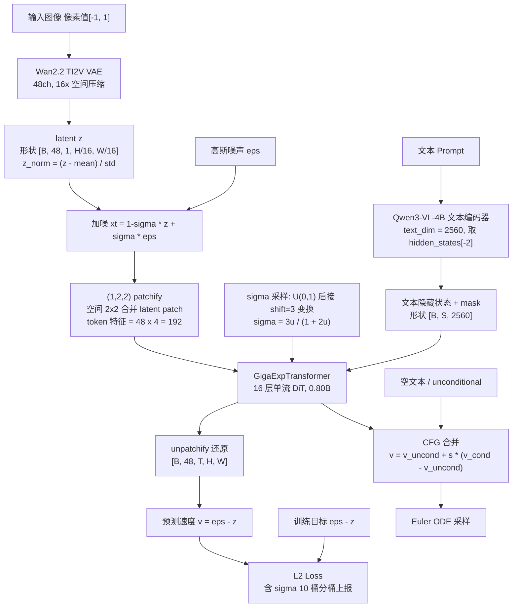
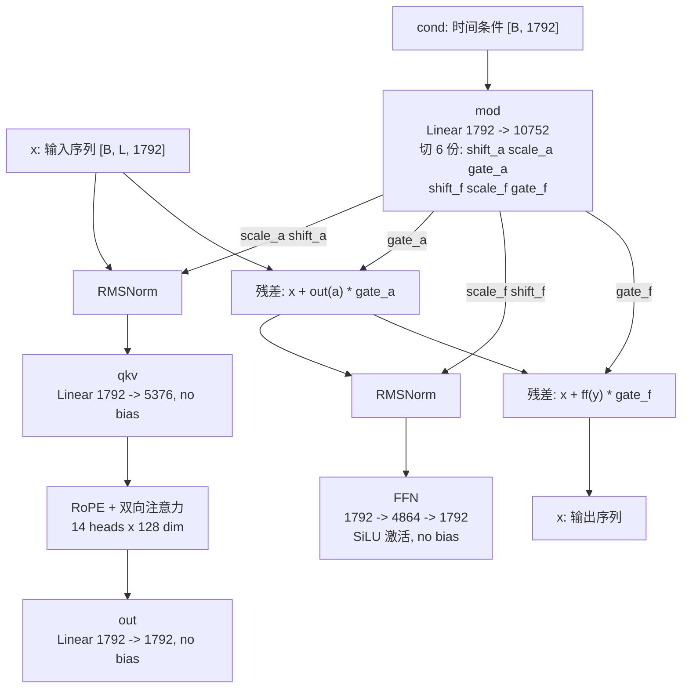

# Giga-Exp · 图像生成研究沙盒

> 自建 DiT 训练 + 推理 + 评测的一体化实验仓库，同时兼作 **FLUX.3 Klein Base** 与 **MOSS-Image-SFT** 两个外部 checkpoint 的推理对照环境。

[](https://www.python.org/)
[](https://pytorch.org/)
[](https://github.com/huggingface/diffusers)
[]()

---

## 目录

- [项目概览](#项目概览)
- [效果示例](#效果示例)
- [核心架构](#核心架构)
- [目录结构](#目录结构)
- [环境准备](#环境准备)
- [训练](#训练)
- [推理](#推理)
- [数据管道](#数据管道)
- [评测工具](#评测工具)
- [训练阶段与配置](#训练阶段与配置)
- [运维与排障](#运维与排障)
- [延伸文档](#延伸文档)

---

## 项目概览

本仓库围绕 **Giga-Exp**（0.80B 稠密单流 DiT 文本到图像 Flow Matching 模型）构建，覆盖从数据准备、分布式训练、推理采样到无参考图像评测的完整链路。

<div align="center">
  
  <p><em>Giga-Exp stage_1 (step 55000, 512p, CFG 3.0, 40 steps) 生成样例</em></p>
</div>

三条并行的技术线：

| 线路 | 入口 | 说明 |
|---|---|---|
| **Giga-Exp 自研模型** | `scripts/train/train_giga_exp.py` | 自建 DiT + 自建数据管道 + DeepSpeed ZeRO-2 训练主线 |
| **FLUX.3 Klein Base** | `scripts/infer/infer.py` | 外部 checkpoint 推理对照（Diffusers modular pipeline） |
| **MOSS-Image-SFT** | `scripts/infer/infer_moss_image.py` | 外部 checkpoint 推理对照（支持 JSON Layout 文字排版） |

### 技术特点

| 特性 | 说明 |
|---|---|
| **单流联合注意力** | 图像 token 与文本 token 拼接进同一组 Block，文本位置使用独立位置轴 |
| **(1,2,2) patchify** | 时间维不合并、空间 2×2 合并，图像 token 数降至 1/4，训练吞吐显著提升 |
| **4D Spacetime RoPE** | `(time, height, width, text_position)` 四轴，时间轴完整保留 → 图像模型可直接平移到视频 |
| **分桶采样不重复** | 桶耗尽后不回绕，改由同比例高分桶借图降采样，避免模型记住高频样本 |
| **常驻解码子进程** | 复用 decode 子进程，消除每样本 fork + import 开销；坏数据分类隔离不中断训练 |
| **三级断点恢复** | 完整 DeepSpeed state → 纯权重快照 → 从零开始，自动降级且保留 step 计数 |
| **无参考图像评测** | 7 个 reference-free 指标 + VLM API 打分，自动读取 `manifest.json` 对齐 prompt |

---

## 效果示例

### 训练期验证：INPUT 对比 GENERATED

每次 validation（默认每 1000 步）按 rank 落盘对比图：左为训练批次原图，右为模型重建结果，顶部黄色为该样本的 caption。

<div align="center">
  
  <p><em>stage_1p1 · step 196000 · rank0 · 樱花场景</em></p>
</div>

### σ-shift 消融对比

同一权重、同一 prompt、同一 seed 下对比四组采样 shift（`1 / 3 / 6 / 9`）。shift 控制噪声调度的时间分布：shift 越大，高噪声段（决定整体构图）占比越长。

<div align="center">
  
  <p><em>同一 step-55000 权重下的 shift 消融</em></p>
</div>

### MOSS-Image-SFT 对照

<div align="center">
  
  <p><em>MOSS-Image-SFT · 256p 生成样例</em></p>
</div>

MOSS-Image-SFT 支持 **JSON Layout Prompt**，可在图中指定文字内容与精确位置：

<div align="center">
  
  <p><em>JSON Layout 指定标题与正文的排版</em></p>
</div>

### FLUX.3 Klein Base 对照

<div align="center">
  
  <p><em>FLUX.3 Image Klein Base · 1024×1024 · CFG 3.5 · 50 steps</em></p>
</div>

---

## 核心架构

### 训练 / 推理数据流



训练目标为 Flow Matching 的速度预测（v-prediction）：

```text
加噪:      xt = (1 - sigma) * z + sigma * eps
目标:      v* = eps - z
损失:      L = MSE(v_pred, v*)           (per-sample 再按 sigma 等宽 10 桶聚合)
sigma 采样: u ~ U(0,1), sigma = shift * u / (1 + (shift-1) * u), shift = 3.0
```

推理时用 Euler ODE 从 sigma=1（纯噪声）积分到 sigma=0（数据），每步 `x <- x - v / num_steps`。

### 单层 GigaBlock

每层拥有**独立的 adaLN 风格调制层**，从全局时间条件生成 6 组参数分别作用于 attention 与 FFN 支路。



### 参数量明细

总量 **801,907,648 ≈ 0.80B**，bf16 权重约 1.6 GB。

| 部分 | 参数量 | 占比 |
|---|---|---|
| 16 × GigaBlock | 792,952,832 (49,559,552/层) | 98.9% |
| `text_in` (2560→1792) | 4,589,312 | 0.57% |
| `time_in` (256→1792→1792) | 3,673,600 | 0.46% |
| `patch_in` (192→1792) | 345,856 | 0.04% |
| final norm + `out` (1792→192) | 346,048 | 0.04% |

### 关键配置速查

```text
hidden dimension        1792
FFN dimension           4864
attention heads         14  (head_dim = 128)
main DiT layers         16
latent channels         48  (Wan2.2 VAE)
patch size (t/h/w)      (1, 2, 2)  时间不合并, 空间 2x2
text hidden dimension   2560  (Qwen3-VL-4B-Instruct, hidden_states[-2])
RoPE axes (t/h/w/l)     16 / 48 / 48 / 16, theta = 10000 (patchify 后网格)
CFG guidance scale      3.0 (validation/inference)
CFG training dropout    0.1 (empty-text unconditional training)
scheduler               flow matching, shift = 3.0 (uniform u)
attention               bidirectional, FA3 优先 / SDPA 回退
optimizer               Muon(2D, lr=3x, match_rms_adamw) + AdamW(out.*/1D)
precision               bf16 mixed, DeepSpeed ZeRO-2, grad clip 1.0
```

各训练分辨率的 image token 数（方形桶）：

| 阶段 | 分辨率 | latent 网格 | patchify 后网格 | image tokens |
|---|---|---|---|---|
| stage_1 | 192p | 12 × 12 | 6 × 6 | 36 |
| stage_1_1 | 256p | 16 × 16 | 8 × 8 | 64 |
| stage_1_2 / stage_2_0 | 512p | 32 × 32 | 16 × 16 | 256 |

加上最长 512 个文本 token，最长序列约 768。

> 更多结构细节见 [docs/giga_exp_architecture.md](docs/giga_exp_architecture.md)。

---

## 目录结构

```text
model_exp/
├── configs/                            # 训练配置 (YAML) + DeepSpeed 配置
│   ├── stage_1.yaml                    # 主线: 28 层 / 512p / AdamW
│   ├── stage_1_1.yaml                  # 16 层 0.80B / 512p / Muon+AdamW
│   ├── stage_2_0.yaml                  # SFT 阶段: 低学习率短程微调
│   └── zero2.json                      # DeepSpeed ZeRO-2
│
├── data/                                # 数据管道
│   ├── lmdb_dataset.py                 # GigaLMDBDataset 适配器
│   ├── datasets/
│   │   ├── image_database.py           # LMDB + Parquet 混合存储读取
│   │   └── video_decode.py             # 媒体解码子系统 (隔离 / 常驻子进程)
│   └── samplers/bucket_sampler.py      # 分桶加权 batch 采样器
│
├── models/
│   └── giga_transformer.py             # GigaExpTransformer (DiT 主干)
│
├── pipeline/
│   └── giga_pipeline.py                # GigaExpPipeline (from_pretrained 入口)
│
├── scripts/
│   ├── train/                          # 训练入口 + launcher + 数学回归测试
│   │   ├── train_giga_exp.py           # 核心训练脚本 (DeepSpeed)
│   │   ├── train_giga_exp_stage_1.sh   # stage_1 launcher
│   │   └── test_model_math.py          # RoPE / patchify 精度回归
│   ├── infer/                          # 三条推理线
│   │   ├── infer_giga_exp.py           # Giga-Exp T2I (支持多 prompt)
│   │   ├── infer.py                    # FLUX.3 Klein Base
│   │   └── infer_moss_image.py         # MOSS-Image-SFT
│   ├── data/build_index_cache.py       # 预构建数据集索引缓存
│   └── test/                           # 优化器 / 解码器 / FA3 验证脚本
│
├── tools/                              # 无参考图像评测工具链
│   ├── image_eval.py                   # 评测 CLI 主入口
│   ├── image_eval_scorers.py           # 7 个 reference-free 指标实现
│   ├── image_eval_steps.py             # 批量评测多个 step 目录
│   └── image_eval_vlm.py               # VLM API 打分
│
├── docs/                               # 架构 / 排障 / 推理文档
│   └── images/                         # README 配图
│
├── thirdparty/flash_attn_3/            # FA3 预编译 CUDA 扩展 (不入库)
├── diffusers/                          # vendored Diffusers main (不入库)
│
├── outputs/                            # 推理产物 (不入库)
└── requirements.txt
```

---

## 环境准备

### 基础依赖

```bash
cd /home/jovyan/pfs/users/zhanqian.wu/code/model_exp
pip install -r requirements.txt
```

`requirements.txt` 仅覆盖通用依赖；训练线还需额外安装：

```bash
pip install deepspeed wandb swanlab lmdb pyarrow tqdm
```

### 外部资源

| 资源 | 路径 | 用途 |
|---|---|---|
| Giga-Exp 数据集 | `/home/jovyan/pfs/users/zhanqian.wu/pfs_data/unified_images_lmdb` | 23 个图像源的 LMDB + Parquet 混合存储 |
| Qwen3-VL-4B-Instruct | `/mnt/nfs/models/huggingface/Qwen/Qwen3-VL-4B-Instruct` | 文本编码器（2560 维） |
| Wan2.2 TI2V-5B VAE | `/mnt/nfs/models/huggingface/models--Wan-AI--Wan2.2-TI2V-5B-Diffusers` | VAE（48 通道 latent） |
| FLUX.3 Klein Base | `/home/jovyan/pfs/users/zhanqian.wu/ckpt/flux-3-image-klein-base` | 外部 checkpoint 推理对照 |
| MOSS-Image-SFT | `/home/jovyan/pfs/users/zhanqian.wu/ckpt/MOSS-Image-SFT` | 外部 checkpoint 推理对照 |
| FlashAttention 3 | `thirdparty/flash_attn_3/` | 预编译 CUDA 扩展（不入库，需自行放置） |

FA3 缺失时 `models/giga_transformer.py` 会自动回退到 PyTorch SDPA，功能不受影响，仅速度下降。

---

## 训练

### 单机 8 卡

```bash
cd /home/jovyan/pfs/users/zhanqian.wu/code/model_exp
CONFIG=configs/stage_1.yaml bash scripts/train/train_giga_exp_stage_1.sh
```

### 多机多卡

每台机器设置以下环境变量后执行同一个 launcher：

```bash
export WORLD_SIZE=6        # 机器总数
export RANK=0             # 本机编号 (0..5)
export MASTER_ADDR=10.0.0.1
export MASTER_PORT=29500
export NPROC_PER_NODE=8   # 每机 GPU 数

CONFIG=configs/stage_1_1.yaml bash scripts/train/train_giga_exp_stage_1_1.sh
```

日志按节点分目录存放：`{output_dir}/logs/{run_id}/node{RANK}/console.log`。

### launcher 内置的环境优化

`train_giga_exp_stage_1.sh` 已处理以下问题，开箱即用：

| 处理 | 原因 |
|---|---|
| `LD_PRELOAD` 预加载与驱动同版本 `libcuda` | 规避 `CUDA Error 803`（compat 目录命中旧版 libcuda） |
| `YISU_IMAGE_TIMEOUT_SECONDS=48` | Lustre 冷读首帧 ~11s，避免误判超时换图 |
| `YISU_IMAGE_PERSISTENT_DECODER=1` | 常驻解码子进程，消除每样本 fork 开销 |
| `NCCL_DEBUG=WARN` | 平时静默，通信异常时能看到原因 |
| `TORCH_LOGS=recompiles` | 打印 dynamo 重编译原因，定位反复重编译 |
| 编译缓存指向 `$OUTPUT_DIR/compile_cache` | 放 PFS 上所有机器共享，重启/换机零重编译 |
| 按 `node{RANK}` 分日志目录 | 避免多机日志互相覆盖 |

### 预构建索引缓存

首次训练需扫描 NFS 上数千个 parquet 分片，建议先单独跑一次：

```bash
python scripts/data/build_index_cache.py --config configs/stage_1.yaml
```

缓存落在 `{output_dir}/dataset_index_cache`，后续启动直接命中，不再重复扫描。可用 `GWP_DATASET_INDEX_CACHE_DISABLE=1` 强制重建。

### 断点恢复

`training.resume_mode` 控制恢复策略，三级自动降级：

```text
1. 完整 DeepSpeed state (模型 + Muon/AdamW state + lr scheduler + step)
2. 兼容纯权重恢复: load_compatible_state_dict
   - 形状一致参数逐位继承
   - patchify 形状变化时迁移: patch_in 旧输入权重扩展 2x2,
     out 旧权重/bias 复制到每个 patch 位置
   - step 从文件名继承 (step-00036000.safetensors -> step=36000)
3. 从 0 开始
```

配置取值：

| `resume_mode` | 行为 |
|---|---|
| `auto` | 自动取 `output_dir` 下最新 state/weights（**推荐**） |
| `none` | 不恢复 |
| 显式路径 | 强制从指定 `.safetensors` / `.pt` / weights 目录恢复 |

> ⚠️ 优化器结构变更（如从 `muon+adam` 切回纯 `adamw`）时，旧 checkpoint 的 optimizer state 不匹配，会自动降级为纯权重恢复（step 保留、optimizer 状态重置），日志有 ⚠️ 提示，属预期行为。

---

## 推理

### Giga-Exp T2I 推理

```bash
cd /home/jovyan/pfs/users/zhanqian.wu/code/model_exp

python scripts/infer/infer_giga_exp.py \
  --prompt 'A fluffy orange cat sitting on a windowsill, warm morning light, photorealistic.' \
  --prompt 'Snow-capped mountain range at sunrise, golden alpenglow, cinematic.' \
  --height 512 --width 512 \
  --steps 40 --guidance-scale 3.0 --shift 3.0 \
  --seed 42 \
  --output-dir outputs/pretrain_v2/vis_token_exp/step-00055000/shift_3
```

常用参数：

| 参数 | 默认 | 说明 |
|---|---|---|
| `--prompt` | — | 单条 prompt，**可重复传入**构成 list |
| `--prompt-file` | — | prompt 文件，每行一条，空行忽略 |
| `--checkpoint` | 取 `output_dir/checkpoints/weights` 最新 | 权重文件或含 `step-*` 的目录 |
| `--height` / `--width` | 128 / 192 | 必须是 **32 的倍数**（VAE 16× 压缩 × patchify 2×2） |
| `--steps` | 40 | 采样步数（训练验证用 20，质量优先可加到 40+） |
| `--guidance-scale` | 3.0 | CFG 强度 |
| `--shift` | 取 `scheduler.validation_shift` | σ 调度 shift |
| `--seed` | 42 | 固定噪声种子，所有 prompt 共用 |
| `--batch-size` | 4 | 分批大小，**结果与 batch 大小无关**（逐条独立生成器） |

输出目录含每张 PNG 与 `manifest.json`（记录 checkpoint、step、采样参数、prompt），可直接被评测工具读取。

### 四组 shift 消融一键对比

`scripts/infer/infer_giga_exp.sh` 内置 20 条 prompt，自动跑 `shift = 1 / 3 / 6 / 9` 四组：

```bash
bash scripts/infer/infer_giga_exp.sh
```

覆盖参数：

```bash
CHECKPOINT=outputs/.../step-00055000.safetensors \
OUTPUT_DIR=outputs/pretrain_v2/vis_token_exp/my_run \
HEIGHT=512 WIDTH=512 STEPS=40 GPU=7 \
bash scripts/infer/infer_giga_exp.sh
```

> 脚本在启动时一次性选定 checkpoint，避免训练期间新权重写入导致四组对比不一致。

### FLUX.3 Klein Base

```bash
cd /home/jovyan/pfs/users/zhanqian.wu/code/model_exp

CUDA_VISIBLE_DEVICES=0 \
PROMPT='A detailed cinematic photograph of a red fox in a snowy forest at golden hour.' \
OUTPUT=outputs/fox.png \
bash scripts/infer/infer_flux3_klein_base.sh
```

直接调用 Python 入口：

```bash
python scripts/infer/infer.py 'A detailed full-scene caption...' \
  --output outputs/fox.png \
  --seed 0 --steps 50 --guidance-scale 3.5
```

参考图编辑（`--image` 最多可重复 10 次）：

```bash
python scripts/infer/infer.py 'A complete caption describing the edited target image...' \
  --image input.png \
  --output outputs/edited.png
```

显存与 prompt upsampler：

- Base 模型默认 50 步、CFG 3.5，VAE 使用 FP32，其余组件 BF16。
- 显存不足时增加 `--cpu-offload`。
- 默认不加载独立的 9B prompt upsampler，因此应传入包含主体、构图、光照、材质和背景的完整场景描述。
- 已下载 PUP 或允许联网下载时，可增加 `--use-prompt-upsampler`；若需在线补文件，再增加 `--allow-download` 并设置 `HF_HUB_OFFLINE=0`。

### MOSS-Image-SFT

```bash
cd /home/jovyan/pfs/users/zhanqian.wu/code/model_exp

CUDA_VISIBLE_DEVICES=0 python scripts/infer/infer_moss_image.py \
  'A wide view of a refrigerator beside a kitchen counter with a fruit bowl. A small sticky note on the refrigerator door is handwritten in Chinese: "记得买牛奶和鸡蛋！"' \
  --output outputs/refrigerator.png \
  --seed 42
```

或使用脚本：

```bash
PROMPT='A red fox in a snowy forest at golden hour.' \
OUTPUT=outputs/fox.png \
bash scripts/infer/infer_moss_image_sft.sh
```

支持 JSON layout prompt、`--negative-prompt`、`--num-images`、`--cpu-offload` 和 `--uncond-skip-layers`（传入但不提供数字即可关闭默认的第 22 层 negative-branch skip）。

> 需要 PyTorch 2.9+、Diffusers 0.38+、Transformers 5.3+ 和 CUDA GPU。

---

## 数据管道

### 存储格式

采用 **Parquet 元数据 + LMDB 图像字节** 的混合存储：

```text
unified_images_lmdb/
├── meta_*.parquet            # 元数据: caption / 宽高 / 来源 / sample_id
└── mdb/{stem}.mdb           # 图像字节, URI 形式 lmdb://{数据集目录}/{分片stem}/{sample_id}
```

LMDB key 同时兼容 `pack`（8 字节 `<Q`）与 `ascii` 两种编码。

### 索引缓存

索引按指纹缓存到 `{output_dir}/dataset_index_cache`：

- `INDEX_CACHE_VERSION = 1` 参与指纹计算，格式变更自动失效重建。
- 环境变量 `GWP_DATASET_INDEX_CACHE` 可指定其他缓存目录，`GWP_DATASET_INDEX_CACHE_DISABLE=1` 强制重建。
- 索引指纹**不含 buckets**，换桶时复用缓存，桶归属在加载后按 `width/height` 重算。

### 分桶与采样

桶像素须被 `BUCKET_PIXEL_MULTIPLE = 32` 整除（VAE 16× 压缩 × patchify 2×2）。

```text
preprocess_style ∈ {cover, resize_long_edge}
  cover            短边贴桶 + 中心裁剪, 无黑边
  resize_long_edge 短边贴桶 + 长边补黑边
```

> 实测 `resize_long_edge` 加权后约 37% 样本补黑 >1%，故主线配置统一使用 `cover`。

**桶耗尽不回绕重复**：不足的 batch 由**同比例高分桶借图降采样**补足（按面积比 `sw*th == tw*sh` 且 `sw > tw` 匹配），单一分辨率层无同比例高分桶时，整批自动切换到仍有余量的桶。

### 媒体解码容错

`data/datasets/video_decode.py` 提供隔离与常驻两条解码路径，并按错误类型分类处置：

| 错误类别 | 处置 |
|---|---|
| `MediaCorruptError` | 跳过该样本，永久拉黑 |
| `MediaInvalidInputError` | 跳过该样本 |
| `MediaTransientIOError` | 临时 IO 失败，TTL 拉黑后重试 |
| `MediaDeadlineError` | 超时预算耗尽，换候选样本 |
| `MediaCapacityError` | 容量不足（含 `MemoryError`），丢弃该 batch（**不拉黑**） |
| `MediaExecutorBugError` | 代码/环境 bug，**立即终止训练** |
| `MediaCandidatesExhausted` | 单样本候选全部失败，按 `invalid_input` 处理 |

数据级错误默认**不中断训练**（连续跳过超过 `GIGA_MAX_CONSECUTIVE_BATCH_SKIPS`，默认 64 才终止）；`executor_bug` 类必须立即终止，避免训练到一半才崩溃。

跨 rank 的 skip 决策通过 `all_reduce` 同步 —— 任一 rank 遇到坏数据则全体跳过该 micro batch，否则各 rank 的 backward/step 通信次数不一致会挂死整个作业。

> ⚠️ **作业运行期间禁止热编辑 `video_decode.py` 及其 import 的模块**。解码子进程每次请求都从磁盘重新读源码，运行中热编辑会导致子进程代码不一致，进而触发整批跳过与多 rank 连锁崩溃。

---

## 评测工具

### 单目录评测

```bash
cd /home/jovyan/pfs/users/zhanqian.wu/code/model_exp

python tools/image_eval.py \
  --images outputs/pretrain_v2/vis_token_exp/step-00055000/shift_3 \
  --metrics all \
  --vlm-workers 8
```

输出 `results.jsonl`（每图一条）与 `summary.json`（各指标 count/mean/std/min/max）。

### 可用指标

| 指标 | 量程 | 说明 |
|---|---|---|
| `clip` | ~0–35 | CLIP 相似度 |
| `siglip` | ~0–1 | SigLIP 相似度 |
| `imagereward` | ~-2–3 | ImageReward 美学分 |
| `pickscore` | ~10–30 | PickScore 偏好分 |
| `musiq` | 0–100 | 主观质量（多尺度） |
| `liqe` | 1–5 | 感知质量 + 一致性 |
| `laion_aes` | ~0–10 | LAION 美学分 |
| `vlm` | 1–10 | VLM API 打分（美学 / 技术质量 / prompt 对齐 / 综合） |

`--list-metrics` 可查看清单。默认 `HF_ENDPOINT=https://hf-mirror.com` 以加速模型下载。

### 批量评测多个 step

```bash
python tools/image_eval_steps.py \
  --root outputs/pretrain_v2/vis_token_exp \
  --metrics musiq,liqe,laion_aes
```

产出 `eval_steps_summary.json` + `eval_steps_table.txt`，用于横向对比不同 checkpoint 的质量曲线。

### Prompt 自动对齐

`--prompts auto`（默认）按以下顺序解析：

1. 图片目录 `manifest.json` 的 `images[].file/prompt`（infer 输出格式）
2. 同名 `.txt`（整文件内容即 prompt）
3. 同名 `.json` 的 `prompt`/`caption`/`text` 字段

也可传 `{"<文件名>": "<prompt>"}` 形式的 JSON，或用 `none` 关闭。

---

## 训练阶段与配置

| 配置 | 阶段 | 模型 | 分辨率 | 桶 | 优化器 | LR | Epoch | CKPT 间隔 |
|---|---|---|---|---|---|---|---|---|
| `stage_1.yaml` | 预训练主线 | 28 层 / 1536 宽 | 512p | 512sq 45%<br>512×384 27.5%<br>384×512 27.5% | AdamW | 8e-5 | 5 | 2500 |
| `stage_1_1.yaml` | 0.80B 预训练 | 16 层 / 1792 宽 | 512p | 384sq 25%<br>384×256 15%<br>256×384 15%<br>512sq 20%<br>512×384 12.5%<br>384×512 12.5% | Muon + AdamW | 8e-5 | 2 | 5000 |
| `stage_2_0.yaml` | SFT 微调 | 16 层 / 1792 宽 | 512p | 512sq 40%<br>512×384 30%<br>384×512 30% | Muon + AdamW | 1e-5 | 2 | 500 |

共有配置：

```text
scheduler            flow_matching, num_train_timesteps 1000, shift 3.0, uniform 采样
cfg_dropout          0.1
lr_scheduler         cosine, lr_warmup_steps 200
mixed_precision      bf16
num_workers          4  +  prefetch_factor 4  (必须保持)
gradient_accumulation_steps  1
validation           every_n_steps 1000, num_inference_steps 20, guidance_scale 3.0, per_rank
wandb                project = giga-exp-image
```

### Muon + AdamW 混合优化器

hidden 2D 矩阵交给 **Muon**（`momentum=0.95`、`weight_decay=0.0`、`adjust_lr_fn=match_rms_adamw`、lr = AdamW base lr 的 3 倍系数 `"3x"`），输出头 `out.*` 与全部 1D 参数（bias/norm）交给 **AdamW**（betas 0.9/0.95、eps 1e-8）。

DeepSpeed ZeRO-2 会把 Muon 组的 2D 参数 flatten 成 1D fp32 分片，因此实现了分片 step：all-gather 还原梯度与 momentum → 逐矩阵 Newton-Schulz → 各 rank 只写回落在自身区间的更新段。

该路径已通过两层验证（`scripts/train/test_zero2_muon.py`）：真实 2 卡 ZeRO-2 下与未分片官方 Muon/AdamW **逐步数值等价**。

### 与 MOSS-Image-SFT 的主要差异

| 维度 | MOSS-Image-SFT | Giga-Exp |
|---|---|---|
| 规模 | 42 层 / 3072 宽 | 16 层 / 1792 宽（0.80B） |
| VAE | FLUX.2 VAE，128ch | Wan2.2 TI2V VAE，48ch |
| 结构 | 双流（文本有独立 TextBlock） | **单流**联合注意力 |
| latent patchify | 无（每 latent 像素 1 token） | **(1,2,2) patchify**，空间 token ×1/4 |
| 文本位置编码 | 4D RoPE 含文本位置 | 4D RoPE 含文本位置 |
| CFG | guidance 3.0，空文本 unconditional | guidance 3.0，空文本 unconditional |
| 时间维 | 图像专用 | **T 保留**，RoPE 含时间轴，可平移到视频 |
| 时间调制 | shared modulation | 每层独立 mod 层（adaLN-zero 风格） |

---

## 运维与排障

### 单元测试与验证脚本

```bash
# 模型数学 (RoPE 精度转换 / patchify 往返)
python scripts/train/test_model_math.py

# 真实 2 卡 ZeRO-2 下 Muon/AdamW 数值等价
python scripts/train/test_zero2_muon.py

# RoPE 在不同 axes_dims 下的 loss 对比 (诊断用)
python scripts/train/test_rope_resume_loss.py

# FA3 varlen 与 masked-SDPA 数值一致性
python scripts/test/test_varlen_fa3.py

# 常驻解码器压测 (吞吐 / 故障重生 / LRU)
python scripts/test/test_persistent_image_decode.py

# 优化器收敛与速度基准
python scripts/test/test_muon_adamw.py
python scripts/test/test_muon_adamw_dit.py
python scripts/test/test_muon_adamw_speed.py
```

### 常见问题

| 现象 | 排查方向 |
|---|---|
| `CUDA Error 803` | launcher 已预加载同版本 `libcuda`，确认走的是 `scripts/train/train_giga_exp_stage_*.sh` |
| 多 rank 连锁崩溃（`TCPStore Broken pipe`） | 查 `console.log` 是否有 `resize_frames() got an unexpected keyword` —— 运行期热编辑解码模块所致 |
| `🚫 本 step 的全部 micro batch 均因坏数据跳过` | 数据侧坏样本累积，查看 `MediaCandidatesExhausted` 计数与 `BadPathBook` |
| dynamo 反复重编译导致卡死 | `TORCH_LOGS=recompiles` 定位元凶；FA3 varlen `max_seqlen` 已改常量上界防重编译风暴 |
| 恢复后 step 归零 | `resume_mode` 显式指向路径时不加载 optimizer state，改用 `auto` |
| 显存不足 | 推理加 `--cpu-offload`；训练降低 `batch_size_per_device` 或提高 `gradient_accumulation_steps` |
| 索引重复扫描 NFS | 先跑 `scripts/data/build_index_cache.py` 预热缓存 |

> 完整的问题排查结论与修复规范见 [docs/spec.md](docs/spec.md) 与 [docs/tasks.md](docs/tasks.md)。

---

## 延伸文档

| 文档 | 内容 |
|---|---|
| [docs/giga_exp_architecture.md](docs/giga_exp_architecture.md) | Giga-Exp 模型结构、参数量明细、RoPE 坐标规则、ZeRO-2 分片 Muon |
| [docs/flux3_architecture.md](docs/flux3_architecture.md) | FLUX.3 Klein Base 结构与组件参数 |
| [docs/moss_image_architecture.md](docs/moss_image_architecture.md) | MOSS-Image-SFT 模型结构 |
| [docs/moss_image_inference.md](docs/moss_image_inference.md) | MOSS-Image-SFT 推理流程与 checkpoint 布局 |
| [docs/spec.md](docs/spec.md) | 问题排查结论与修复规范（RoPE 配对、解码隔离、resume 策略等） |
| [docs/tasks.md](docs/tasks.md) | 修复任务清单与排期约束 |

---

## License

内部研究用途，暂未开放外部许可。
