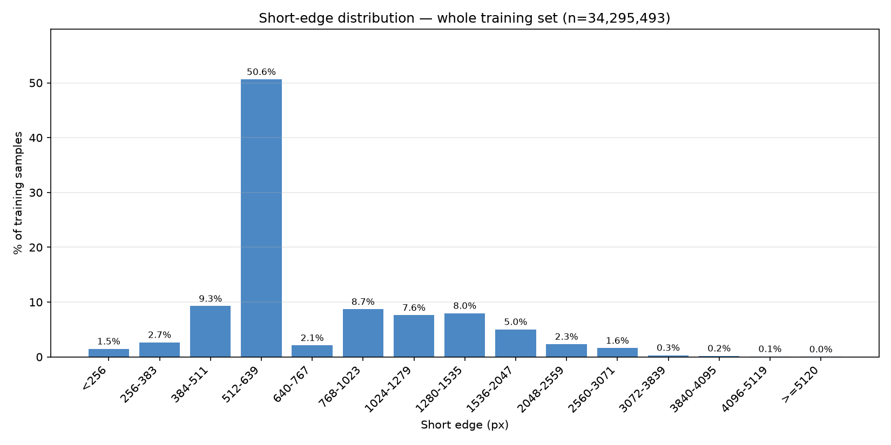
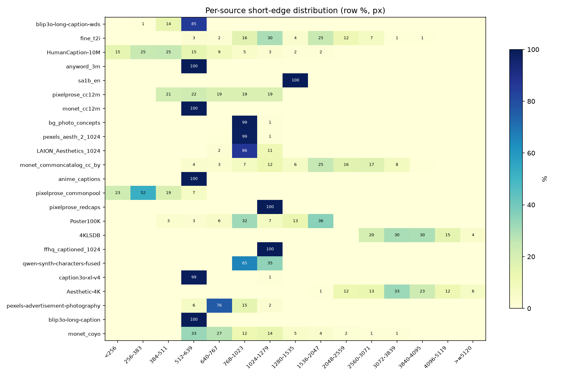
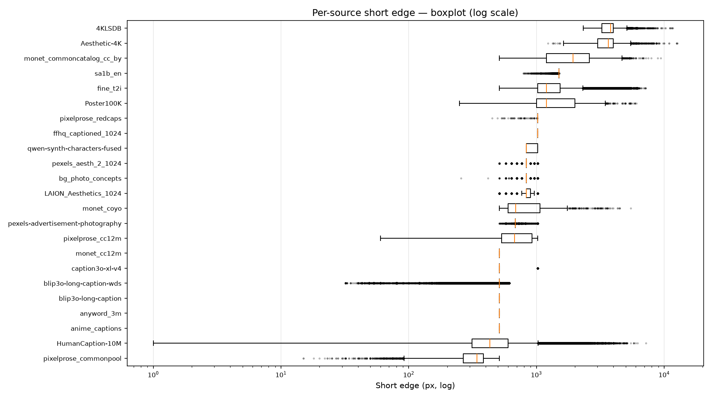
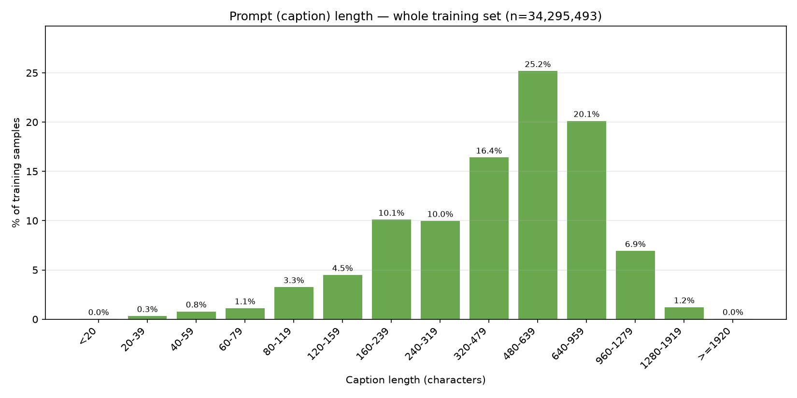
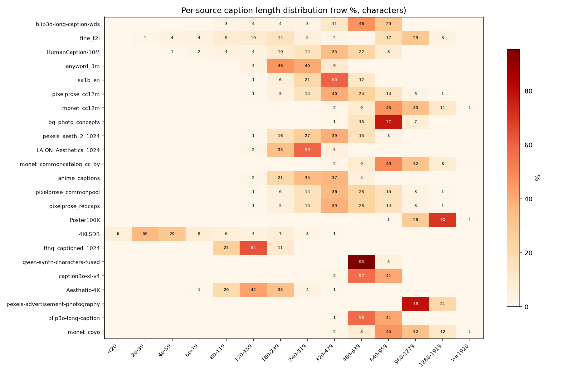
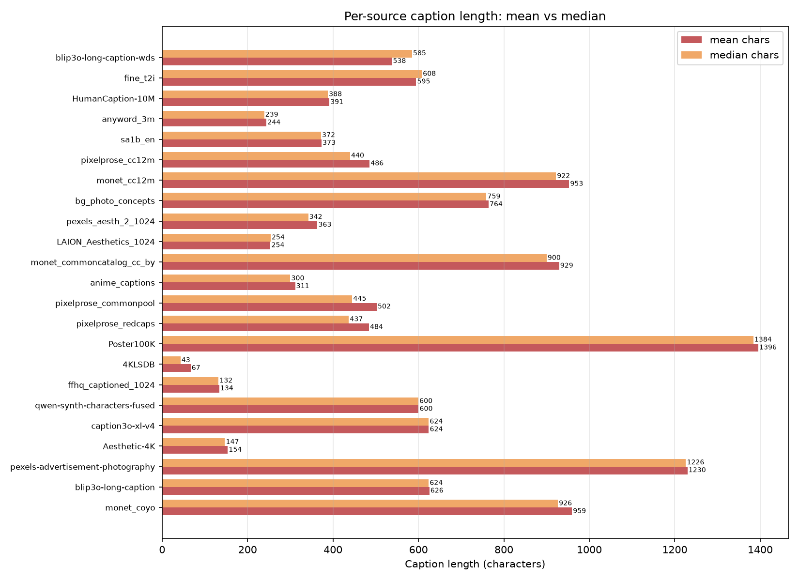

# unified_images_lmdb 数据集分辨率与 Prompt 长度统计

> 统计时间: 2026-10-31 | 数据根目录: `/home/jovyan/pfs/users/zhanqian.wu/pfs_data/unified_images_lmdb`
> 口径: **短边 = min(width, height)**(原始图, 非桶尺寸); **prompt = meta.parquet 的 `caption` 字段**(训练加载器实际使用的文本条件, 见 [image_database.py](file:///home/jovyan/pfs/users/zhanqian.wu/code/model_exp/data/datasets/image_database.py)); 词数按空白切分近似。
> 全库 25 个 source 共 **36,721,646** 条; 其中训练配置 [stage_1_kd_v2.yaml](file:///home/jovyan/pfs/users/zhanqian.wu/code/model_exp/configs/stage_1_kd_v2.yaml) 使用 23 个 source, 共 **34,295,493** 条。下文"整体"均指训练集合。

---

## 1. 整体短边分布

### 1.1 分位数

| 指标 | min | p5 | p25 | 中位数 | p75 | p95 | max | 均值 |
|---|---|---|---|---|---|---|---|---|
| 短边 (px) | 1 | 400 | 512 | **512** | 1,024 | 1,572 | 12,668 | 792.3 |

### 1.2 分桶占比

| 短边区间 (px) | <256 | 256-383 | 384-511 | 512-639 | 640-767 | 768-1023 | 1024-1279 | 1280-1535 | 1536-2047 | 2048-2559 | 2560-3071 | 3072-3839 | 3840-4095 | 4096-5119 | >=5120 |
|---|---|---|---|---|---|---|---|---|---|---|---|---|---|---|---|
| 样本数 | 504,347 | 913,393 | 3,178,299 | 17,364,561 | 721,407 | 2,983,024 | 2,610,494 | 2,731,237 | 1,724,078 | 798,841 | 550,662 | 106,756 | 67,038 | 31,697 | 9,659 |
| 占比 % | 1.5 | 2.7 | 9.3 | 50.6 | 2.1 | 8.7 | 7.6 | 8.0 | 5.0 | 2.3 | 1.6 | 0.3 | 0.2 | 0.1 | 0.0 |

解读: 短边中位数约 512 px, 主体落在 512~2048 区间; <512 的小图占比约 13.4%, >=4096 的超大图约 0.1%。训练按 512 桶 cover 裁剪, 短边 <427 px 的样本受 `max_upscale_ratio: 1.2` 约束。

---

## 2. 各数据集短边分布

### 2.1 分位数一览(按数据量降序)

| Source | 样本数 | 占比 | min | p5 | 中位数 | p95 | max | 均值 |
|---|---|---|---|---|---|---|---|---|
| blip3o-long-caption-wds | 14,928,220 | 43.5% | 32 | 412 | **512** | 512 | 612 | 501.7 |
| fine_t2i | 6,314,117 | 18.4% | 512 | 768 | **1,200** | 2,560 | 7,162 | 1,395.2 |
| HumanCaption-10M | 2,850,000 | 8.3% | 1 | 190 | **431** | 1,080 | 7,200 | 504.9 |
| anyword_3m | 2,499,906 | 7.3% | 512 | 512 | **512** | 512 | 512 | 512.0 |
| sa1b_en | 2,419,604 | 7.1% | 790 | 1,500 | **1,500** | 1,500 | 1,500 | 1,499.8 |
| pixelprose_cc12m | 1,491,026 | 4.3% | 60 | 411 | **675** | 1,024 | 1,024 | 712.4 |
| monet_cc12m | 794,446 | 2.3% | 512 | 512 | **512** | 512 | 512 | 512.0 |
| bg_photo_concepts | 567,520 | 1.7% | 256 | 768 | **832** | 896 | 1,024 | 833.5 |
| pexels_aesth_2_1024 | 549,583 | 1.6% | 512 | 768 | **832** | 896 | 1,024 | 831.7 |
| LAION_Aesthetics_1024 | 382,412 | 1.1% | 512 | 768 | **832** | 1,024 | 1,024 | 849.8 |
| monet_commoncatalog_cc_by | 380,883 | 1.1% | 512 | 681 | **1,936** | 3,264 | 9,407 | 1,928.9 |
| anime_captions | 337,038 | 1.0% | 512 | 512 | **512** | 512 | 512 | 512.0 |
| pixelprose_commonpool | 261,479 | 0.8% | 15 | 193 | **341** | 512 | 512 | 329.8 |
| pixelprose_redcaps | 159,152 | 0.5% | 450 | 1,024 | **1,024** | 1,024 | 1,024 | 1,023.9 |
| Poster100K | 89,033 | 0.3% | 250 | 600 | **1,200** | 2,000 | 6,075 | 1,351.9 |
| 4KLSDB | 87,699 | 0.3% | 2,319 | 2,789 | **3,801** | 4,912 | 11,714 | 3,746.1 |
| ffhq_captioned_1024 | 70,000 | 0.2% | 1,024 | 1,024 | **1,024** | 1,024 | 1,024 | 1,024.0 |
| qwen-synth-characters-fused | 42,213 | 0.1% | 832 | 832 | **832** | 1,024 | 1,024 | 898.6 |
| caption3o-xl-v4 | 29,047 | 0.1% | 512 | 512 | **512** | 512 | 1,024 | 517.3 |
| Aesthetic-4K | 14,985 | 0.0% | 1,227 | 2,160 | **3,648** | 5,304 | 12,668 | 3,618.9 |
| pexels-advertisement-photography | 12,917 | 0.0% | 512 | 576 | **682** | 819 | 1,024 | 703.2 |
| blip3o-long-caption | 12,189 | 0.0% | 512 | 512 | **512** | 512 | 512 | 512.0 |
| monet_coyo | 2,024 | 0.0% | 512 | 533 | **686** | 1,920 | 5,459 | 904.0 |

### 2.2 短边分桶占比(行内 %)

| Source | <256 | 256-383 | 384-511 | 512-639 | 640-767 | 768-1023 | 1024-1279 | 1280-1535 | 1536-2047 | 2048-2559 | 2560-3071 | 3072-3839 | 3840-4095 | 4096-5119 | >=5120 |
|---|---|---|---|---|---|---|---|---|---|---|---|---|---|---|---|
| blip3o-long-caption-wds | 0 | 1 | 14 | 85 | 0 | 0 | 0 | 0 | 0 | 0 | 0 | 0 | 0 | 0 | 0 |
| fine_t2i | 0 | 0 | 0 | 3 | 2 | 16 | 30 | 4 | 25 | 12 | 7 | 1 | 1 | 0 | 0 |
| HumanCaption-10M | 15 | 25 | 25 | 15 | 9 | 5 | 3 | 2 | 2 | 0 | 0 | 0 | 0 | 0 | 0 |
| anyword_3m | 0 | 0 | 0 | 100 | 0 | 0 | 0 | 0 | 0 | 0 | 0 | 0 | 0 | 0 | 0 |
| sa1b_en | 0 | 0 | 0 | 0 | 0 | 0 | 0 | 100 | 0 | 0 | 0 | 0 | 0 | 0 | 0 |
| pixelprose_cc12m | 0 | 0 | 21 | 22 | 19 | 19 | 19 | 0 | 0 | 0 | 0 | 0 | 0 | 0 | 0 |
| monet_cc12m | 0 | 0 | 0 | 100 | 0 | 0 | 0 | 0 | 0 | 0 | 0 | 0 | 0 | 0 | 0 |
| bg_photo_concepts | 0 | 0 | 0 | 0 | 0 | 99 | 1 | 0 | 0 | 0 | 0 | 0 | 0 | 0 | 0 |
| pexels_aesth_2_1024 | 0 | 0 | 0 | 0 | 0 | 99 | 1 | 0 | 0 | 0 | 0 | 0 | 0 | 0 | 0 |
| LAION_Aesthetics_1024 | 0 | 0 | 0 | 0 | 2 | 86 | 11 | 0 | 0 | 0 | 0 | 0 | 0 | 0 | 0 |
| monet_commoncatalog_cc_by | 0 | 0 | 0 | 4 | 3 | 7 | 12 | 6 | 25 | 16 | 17 | 8 | 0 | 0 | 0 |
| anime_captions | 0 | 0 | 0 | 100 | 0 | 0 | 0 | 0 | 0 | 0 | 0 | 0 | 0 | 0 | 0 |
| pixelprose_commonpool | 23 | 52 | 19 | 7 | 0 | 0 | 0 | 0 | 0 | 0 | 0 | 0 | 0 | 0 | 0 |
| pixelprose_redcaps | 0 | 0 | 0 | 0 | 0 | 0 | 100 | 0 | 0 | 0 | 0 | 0 | 0 | 0 | 0 |
| Poster100K | 0 | 0 | 3 | 3 | 6 | 32 | 7 | 13 | 36 | 0 | 0 | 0 | 0 | 0 | 0 |
| 4KLSDB | 0 | 0 | 0 | 0 | 0 | 0 | 0 | 0 | 0 | 0 | 20 | 30 | 30 | 15 | 4 |
| ffhq_captioned_1024 | 0 | 0 | 0 | 0 | 0 | 0 | 100 | 0 | 0 | 0 | 0 | 0 | 0 | 0 | 0 |
| qwen-synth-characters-fused | 0 | 0 | 0 | 0 | 0 | 65 | 35 | 0 | 0 | 0 | 0 | 0 | 0 | 0 | 0 |
| caption3o-xl-v4 | 0 | 0 | 0 | 99 | 0 | 0 | 1 | 0 | 0 | 0 | 0 | 0 | 0 | 0 | 0 |
| Aesthetic-4K | 0 | 0 | 0 | 0 | 0 | 0 | 0 | 0 | 1 | 12 | 13 | 33 | 23 | 12 | 6 |
| pexels-advertisement-photography | 0 | 0 | 0 | 6 | 76 | 15 | 2 | 0 | 0 | 0 | 0 | 0 | 0 | 0 | 0 |
| blip3o-long-caption | 0 | 0 | 0 | 100 | 0 | 0 | 0 | 0 | 0 | 0 | 0 | 0 | 0 | 0 | 0 |
| monet_coyo | 0 | 0 | 0 | 33 | 27 | 12 | 14 | 5 | 4 | 2 | 1 | 1 | 0 | 0 | 0 |

要点: 主力源 blip3o-long-caption-wds 高度集中在 512 px(p5-p95 = 412-512); fine_t2i 集中在 768~2560; sa1b_en 恒为 1500。小图主要是 HumanCaption-10M(中位 431 px, 约 65% 样本 <512)与 pixelprose_commonpool(中位 341, 94% <512); 大图源 4KLSDB/Aesthetic-4K 全部 >=1024(4KLSDB min 即 2319), Poster100K 中位 1200 但 p5 低至 600。

---

## 3. 整体 Prompt 长度

### 3.1 分位数

| 指标 | min | p5 | p25 | 中位数 | p75 | p95 | max | 均值 |
|---|---|---|---|---|---|---|---|---|
| 字符数 | 0 | 114 | 276 | **511** | 659 | 1,065 | 163,914 | 510.4 |
| 词数 | - | - | - | **87** | - | 172 | - | 85.1 |

### 3.2 分桶占比

| 字符区间 | <20 | 20-39 | 40-59 | 60-79 | 80-119 | 120-159 | 160-239 | 240-319 | 320-479 | 480-639 | 640-959 | 960-1279 | 1280-1919 | >=1920 |
|---|---|---|---|---|---|---|---|---|---|---|---|---|---|---|
| 样本数 | 7,603 | 112,812 | 270,745 | 383,585 | 1,119,361 | 1,540,817 | 3,463,202 | 3,422,745 | 5,627,716 | 8,637,456 | 6,900,754 | 2,377,873 | 419,500 | 11,324 |
| 占比 % | 0.0 | 0.3 | 0.8 | 1.1 | 3.3 | 4.5 | 10.1 | 10.0 | 16.4 | 25.2 | 20.1 | 6.9 | 1.2 | 0.0 |

---

## 4. 各数据集 Prompt 长度

### 4.1 分位数一览(按均值字符数降序)

| Source | 样本数 | 字符 min | 字符中位数 | 字符均值 | 字符 p95 | 字符 max | 词数中位数 | 词数均值 |
|---|---|---|---|---|---|---|---|---|
| Poster100K | 89,033 | 51 | 1,384 | **1,395.5** | 1,741 | 11,814 | 220 | 221.7 |
| pexels-advertisement-photography | 12,917 | 1,031 | 1,226 | **1,229.8** | 1,346 | 1,548 | 179 | 180.1 |
| monet_coyo | 2,024 | 195 | 926 | **959.4** | 1,467 | 3,100 | 151 | 157.5 |
| monet_cc12m | 794,446 | 82 | 922 | **952.7** | 1,439 | 4,834 | 152 | 156.7 |
| monet_commoncatalog_cc_by | 380,883 | 79 | 900 | **929.4** | 1,389 | 163,914 | 147 | 151.2 |
| bg_photo_concepts | 567,520 | 190 | 759 | **764.1** | 982 | 1,530 | 131 | 132.0 |
| blip3o-long-caption | 12,189 | 0 | 624 | **625.7** | 741 | 917 | 100 | 100.7 |
| caption3o-xl-v4 | 29,047 | 166 | 624 | **624.2** | 743 | 2,161 | 100 | 100.6 |
| qwen-synth-characters-fused | 42,213 | 454 | 600 | **600.4** | 638 | 696 | 104 | 103.5 |
| fine_t2i | 6,314,117 | 0 | 608 | **594.6** | 1,240 | 2,578 | 100 | 96.3 |
| blip3o-long-caption-wds | 14,928,220 | 8 | 585 | **538.0** | 739 | 1,196 | 95 | 88.3 |
| pixelprose_commonpool | 261,479 | 3 | 445 | **502.3** | 968 | 16,846 | 84 | 94.1 |
| pixelprose_cc12m | 1,491,026 | 3 | 440 | **485.6** | 886 | 18,374 | 83 | 91.7 |
| pixelprose_redcaps | 159,152 | 9 | 437 | **484.2** | 890 | 5,613 | 82 | 90.6 |
| HumanCaption-10M | 2,850,000 | 36 | 388 | **391.4** | 689 | 3,571 | 71 | 70.8 |
| sa1b_en | 2,419,604 | 20 | 372 | **373.2** | 526 | 2,216 | 66 | 66.2 |
| pexels_aesth_2_1024 | 549,583 | 19 | 342 | **363.4** | 596 | 1,198 | 57 | 60.6 |
| anime_captions | 337,038 | 30 | 300 | **311.5** | 482 | 755 | 53 | 54.5 |
| LAION_Aesthetics_1024 | 382,412 | 33 | 254 | **253.5** | 320 | 2,017 | 44 | 43.6 |
| anyword_3m | 2,499,906 | 57 | 239 | **244.3** | 344 | 7,880 | 37 | 38.1 |
| Aesthetic-4K | 14,985 | 36 | 147 | **153.6** | 235 | 449 | 24 | 25.4 |
| ffhq_captioned_1024 | 70,000 | 68 | 132 | **133.7** | 170 | 277 | 23 | 23.2 |
| 4KLSDB | 87,699 | 1 | 43 | **66.7** | 217 | 1,378 | 8 | 12.0 |

### 4.2 字符分桶占比(行内 %)

| Source | <20 | 20-39 | 40-59 | 60-79 | 80-119 | 120-159 | 160-239 | 240-319 | 320-479 | 480-639 | 640-959 | 960-1279 | 1280-1919 | >=1920 |
|---|---|---|---|---|---|---|---|---|---|---|---|---|---|---|
| Poster100K | 0 | 0 | 0 | 0 | 0 | 0 | 0 | 0 | 0 | 0 | 1 | 28 | 70 | 1 |
| pexels-advertisement-photography | 0 | 0 | 0 | 0 | 0 | 0 | 0 | 0 | 0 | 0 | 0 | 79 | 21 | 0 |
| monet_coyo | 0 | 0 | 0 | 0 | 0 | 0 | 0 | 0 | 2 | 8 | 45 | 32 | 12 | 1 |
| monet_cc12m | 0 | 0 | 0 | 0 | 0 | 0 | 0 | 0 | 2 | 9 | 45 | 33 | 11 | 1 |
| monet_commoncatalog_cc_by | 0 | 0 | 0 | 0 | 0 | 0 | 0 | 0 | 2 | 9 | 49 | 32 | 8 | 0 |
| bg_photo_concepts | 0 | 0 | 0 | 0 | 0 | 0 | 0 | 0 | 1 | 15 | 77 | 7 | 0 | 0 |
| blip3o-long-caption | 0 | 0 | 0 | 0 | 0 | 0 | 0 | 0 | 1 | 58 | 41 | 0 | 0 | 0 |
| caption3o-xl-v4 | 0 | 0 | 0 | 0 | 0 | 0 | 0 | 0 | 2 | 57 | 41 | 0 | 0 | 0 |
| qwen-synth-characters-fused | 0 | 0 | 0 | 0 | 0 | 0 | 0 | 0 | 0 | 95 | 5 | 0 | 0 | 0 |
| fine_t2i | 0 | 1 | 4 | 4 | 9 | 10 | 14 | 5 | 2 | 0 | 17 | 29 | 3 | 0 |
| blip3o-long-caption-wds | 0 | 0 | 0 | 0 | 3 | 4 | 4 | 3 | 11 | 46 | 29 | 0 | 0 | 0 |
| pixelprose_commonpool | 0 | 0 | 0 | 0 | 0 | 1 | 6 | 14 | 36 | 23 | 15 | 3 | 1 | 0 |
| pixelprose_cc12m | 0 | 0 | 0 | 0 | 0 | 1 | 5 | 14 | 40 | 24 | 14 | 3 | 1 | 0 |
| pixelprose_redcaps | 0 | 0 | 0 | 0 | 0 | 1 | 5 | 15 | 39 | 23 | 14 | 3 | 1 | 0 |
| HumanCaption-10M | 0 | 0 | 1 | 2 | 4 | 4 | 10 | 14 | 35 | 22 | 8 | 0 | 0 | 0 |
| sa1b_en | 0 | 0 | 0 | 0 | 0 | 1 | 6 | 21 | 60 | 12 | 0 | 0 | 0 | 0 |
| pexels_aesth_2_1024 | 0 | 0 | 0 | 0 | 0 | 1 | 16 | 27 | 39 | 15 | 3 | 0 | 0 | 0 |
| anime_captions | 0 | 0 | 0 | 0 | 0 | 2 | 21 | 35 | 37 | 5 | 0 | 0 | 0 | 0 |
| LAION_Aesthetics_1024 | 0 | 0 | 0 | 0 | 0 | 2 | 33 | 59 | 5 | 0 | 0 | 0 | 0 | 0 |
| anyword_3m | 0 | 0 | 0 | 0 | 0 | 4 | 46 | 40 | 9 | 0 | 0 | 0 | 0 | 0 |
| Aesthetic-4K | 0 | 0 | 0 | 1 | 20 | 42 | 33 | 4 | 1 | 0 | 0 | 0 | 0 | 0 |
| ffhq_captioned_1024 | 0 | 0 | 0 | 0 | 25 | 64 | 11 | 0 | 0 | 0 | 0 | 0 | 0 | 0 |
| 4KLSDB | 6 | 36 | 29 | 8 | 6 | 4 | 7 | 3 | 1 | 0 | 0 | 0 | 0 | 0 |

要点: prompt 最长的是 Poster100K(中位 1,384 字符)与 pexels-advertisement-photography(中位 1,226), monet/pixelprose 系也在 400~1,400 区间; 最短的是 4KLSDB(中位 43)、ffhq_captioned_1024(132)、Aesthetic-4K(147)。占训练集 43.5% 的 blip3o-long-caption-wds 中位 585 字符。整体中位 511 字符(约 87 词), 按 Qwen 分词约 100~150 token, 远低于 text_encoder `max_length: 512` 上限; 仅 monet_commoncatalog_cc_by 的 max 163,914 字符这类极端长尾会在编码时被截断。

---

## 5. 附录: 库中存在但未参与本次训练

| Source | 样本数 | 短边中位数 | 字符均值 | 备注 |
|---|---|---|---|---|
| Text-Render-2M | 2,323,502 | 512 | 408.4 | 不在 stage_1_kd_v2 `image_sources` 列表 |
| GenPoster100K | 102,651 | 1,080 | 493.5 | 不在 stage_1_kd_v2 `image_sources` 列表 |

## 6. 统计方法

- 逐 source 读取 `parquet/meta_*.parquet` 分片(避免与聚合文件 `meta.parquet` 重复计数; `blip3o-long-caption` 无分片, 读其 `meta.parquet`), 仅取 `width/height/caption` 三列。
- 短边过滤 `width/height` 缺失或非正值的行; 全库读取 0 报错, 共 36,721,646 行。
- 与索引缓存 [index stats](file:///home/jovyan/pfs/users/zhanqian.wu/exp/giga_exp_image/stage_1/dataset_index_cache/index_17f9d41415f12085df5661a53fbd0677099f0921f3613f0c740c3d9706c0c363.stats.txt) 对账: 各 source 行数一致(索引另有 10,904 条因无合格 bucket 被过滤, 占比 <0.04%, 不影响分布结论)。
- 图表脚本与中间数据: `/tmp/ds_stats/`(collect.py / plot.py / gen_md.py / *.npy)。
