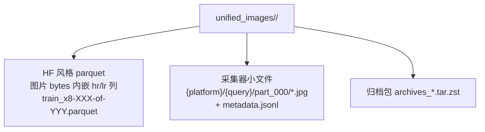
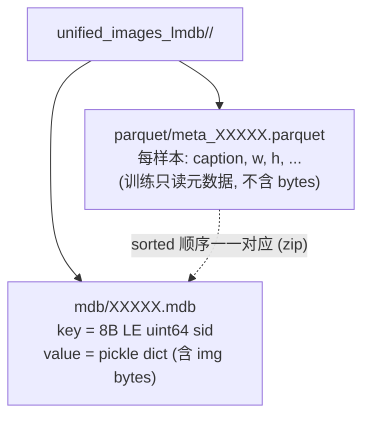
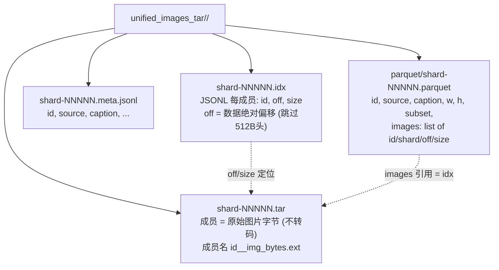
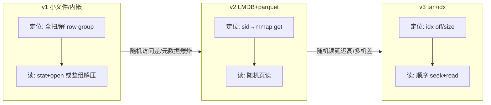
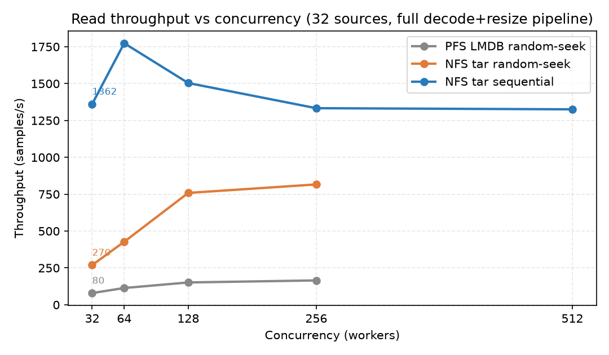
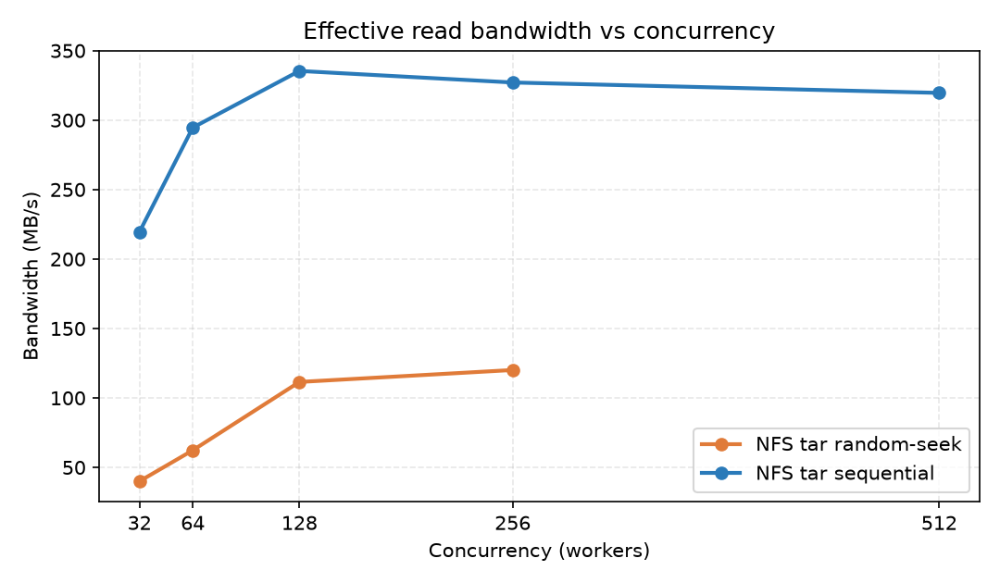
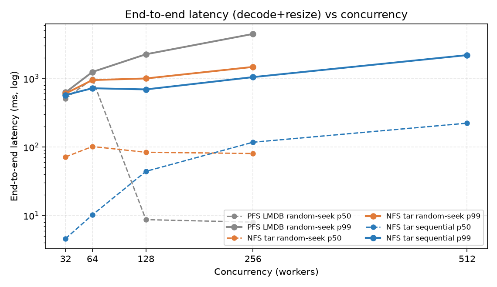

# 图像训练数据集存储设计演进：小文件/内嵌 parquet → LMDB+parquet → 分片 tar

## ⚡ 核心结论：新设计（分片 tar）在 NFS 上跑赢了 PFS

> "共享 NFS 会不会比本机 PFS 慢？" —— **实测相反：NFS 分片 tar 全面超过 PFS LMDB，连随机 seek 都是 PFS 的 5 倍。** 迁移到 NFS tar 无性能代价，只有收益。

| 对比项 | PFS LMDB（现行，本机） | NFS tar 随机 seek | **NFS tar 顺序 seq（推荐）** |
|---|---|---|---|
| 吞吐 (samples/s) | 165 | 816 | **1774** |
| 带宽 (MB/s) | 21 | 120 | **335** |
| 相对 PFS | 1× | 5× | **10.7× / 带宽 16×** |
| 延迟 p99 | 4.5s（随并发爆炸） | 1.5s | **0.7s，且 p50≈5ms** |

（同为 32 源混合、训练分辨率桶、PIL 解码+resize 全管线、单机 8 卡节点实测，详见 §5）

> 2026-11-14 · 压测工具: [tools/bench_read_stress.py](/home/jovyan/pfs/users/zhanqian.wu/code/model_exp/tools/bench_read_stress.py)

## 0. 三代设计一览

| | v1 早期：小文件 / 内嵌 parquet | v2：LMDB + parquet（PFS） | v3：分片 tar + sidecar 索引（NFS，当前） |
|---|---|---|---|
| 根目录 | `unified_images/`、`unified_images_archives_*` | `unified_images_lmdb/`（PFS 本机） | `unified_images_tar/`（NFS 共享） |
| 单样本载体 | 散落 jpg 小文件或 HF parquet 内嵌 `struct<bytes,path>` | LMDB value（pickle dict 含 img bytes） | tar 成员（原始字节，不转码） |
| 元数据 | metadata.jsonl / parquet 列 | parquet shard（caption/w/h…）与 mdb shard sorted 一一对应 | `.meta.jsonl` + `parquet/` shard（含 images 引用） |
| 定位方式 | 全量扫描 | key→mmap 随机 get | `.idx` 记录 off/size，seek 或顺序读 |
| 读取吞吐（实测） | 小文件：元数据 ops 打死，未纳入压测 | **~165 samples/s**（随机 seek 天花板） | seek ~816；**顺序 ~1774** |
| 主要瓶颈 | 千万级文件的 stat/open | 随机读延迟（p99 0.6→4.5s 随并发爆炸） | 客户端 PIL 解码（存储未打满） |

## 1. v1 早期：小文件 / 内嵌 parquet

### 结构图



### 设计与问题

- parquet 内嵌 bytes（`hr: struct<bytes, path>`）：单文件几百 MB，读一张图要整 row group 解码 + 嵌套列解压，随机访问代价极高；适合"整库流水读取"，不适合训练随机采样。
- 散落小文件（jpg + jsonl）：结构直观，但千万级文件让 Lustre/NFS 的 stat/open 元数据操作成为绝对瓶颈，dataloader 大量时间耗在目录遍历与连接建立上。
- 归档 tar.zst：传输用，读取需整包解压，无法随机访问。

**教训**：训练侧需要"一次定位、一次读、粒度=单样本"的布局，于是有 v2。

## 2. v2：LMDB + parquet（PFS，训练现行）

### 结构图



### 设计要点（[tools/data_tools/lmdb_index.py](/home/jovyan/pfs/users/zhanqian.wu/code/model_exp/tools/data_tools/lmdb_index.py)）

- 元数据（parquet）与数据（mdb）分离：训练时仅加载 parquet 建全局索引（caption/桶/采样权重），命中才 `mmap get(sid)`。
- 分片对齐：parquet 分片与 mdb 文件按 sorted zip 一一对应，sid 可定位 shard。
- 两种 key scheme 兼容（二进制 uint64 / ascii 十进制）。

### 实测问题

PFS 这套盘上随机读延迟极高：`get()` p50 从 0.5s（C=32）涨到 4.4s p99（C=256），加并发只是排队，吞吐天花板 **~165 samples/s / 21 MB/s**（见 §5）。多机共享时更差——LMDB 不是为跨机并发随机读设计的。

## 3. v3：分片 tar + sidecar 偏移索引（NFS，当前）

### 结构图



### 设计要点（打包工具 [tools/lmdb_to_tar.py](/home/jovyan/pfs/users/zhanqian.wu/code/model_exp/tools/lmdb_to_tar.py)）

- **一次定位一次读**：`.idx` 流式记录每个成员的绝对偏移，`f.seek(off); f.read(size)` 切出 blob，无需解 tar 结构。
- **顺序读友好**：成员按写入顺序物理连续，按 off 升序读即纯顺序流。
- **原子发布**：`.part` 写完 fsync 后 rename，见正式名即完整；支持断点续传。
- **多模态记录**：edit 对等多图 = parquet `images` 列表多元素，同 shard 连续存储。
- **共享可读**：tar/idx/parquet 均为无状态文件，任意节点直接读，多机天然扩展。
- 格式与读取细节见项目 skill `unified-tar-dataset`（[SKILL.md](/home/jovyan/pfs/users/zhanqian.wu/code/model_exp/.trae/skills/unified-tar-dataset/SKILL.md)，含现成 reader）。

## 4. 三代设计对比



| 维度 | v1 | v2 LMDB | v3 tar |
|---|---|---|---|
| 随机访问粒度 | 差（row group/整包） | 好（单样本 get） | 好（单样本 seek） |
| 顺序流式读取 | 一般 | 差（页分散） | **优（物理连续）** |
| 元数据 ops | 爆炸（千万文件） | 少（parquet shard） | 少（idx shard） |
| 多机共享 | 好（但性能差） | 差（本机 mmap 语义） | **好（无状态文件）** |
| 写入成本 | 低 | 转码/编码一次 | 不转码，一次顺序写 |
| 增量扩源 | 容易 | 容易 | 容易（新源新目录） |
| 实测吞吐 | — | 165 samples/s | **1774 samples/s** |

## 5. 压测：PFS LMDB seek vs NFS tar seek vs NFS tar seq

### 5.1 设计

三种模式共用同一采样表（32 源、46,630,043 行、桶分布与训练一致 512_square ~93%）与同一解码管线（PIL decode + 就近桶 resize），每档 warmup 3s + 计时 20s：

```
parquet 采样表 (32 源, w/h→分辨率桶)
   ├─ pfs-seek:  LMDB mmap get(sid)
   ├─ nfs-seek:  tar 随机 seek(off), 每样本独立 open/seek
   └─ nfs-seq:   worker 独占分片, 按 off 升序连续读, 分片洗牌轮转均摊
   ──────────────► decode → resize → 记延迟/吞吐
```

seq 模式实现要点：全表按 shard 一次 `argsort` 分组（禁止逐分片全表扫描），索引缓存 npz（建表 ~29min，复用 6s）。

### 5.2 数据规模

- NFS tar：26430 分片；PFS LMDB：47.6M 行全量索引。
- 单机 8 卡节点，测试只用 CPU/网络。

### 5.3 结果总表（端到端 = 读+解码+resize）

| 模式 | C | samples/s | MB/s | read p50/p99 (ms) | total p50/p99 (ms) | err |
|---|---|---|---|---|---|---|
| PFS LMDB seek | 32 | 79.6 | 10.0 | 502 / 617 | 509 / 626 | 0 |
| PFS LMDB seek | 64 | 113.8 | 15.9 | 978 / 1233 | 983 / 1244 | 0 |
| PFS LMDB seek | 128 | 151.5 | 18.7 | 4 / 2246 | 9 / 2256 | 0 |
| PFS LMDB seek | 256 | 165.3 | 21.0 | 4 / 4455 | 8 / 4468 | 0 |
| NFS tar seek | 32 | 269.6 | 40.0 | 60 / 594 | 72 / 604 | 0 |
| NFS tar seek | 64 | 427.4 | 62.3 | 88 / 934 | 102 / 948 | 0 |
| NFS tar seek | 128 | 758.7 | 111.5 | 13 / 986 | 84 / 1000 | 0 |
| NFS tar seek | 256 | 816.3 | 120.1 | 10 / 1455 | 80 / 1475 | 1 |
| **NFS tar seq** | 32 | 1361.6 | 219.5 | 0 / 539 | 4.6 / 573 | 0 |
| **NFS tar seq** | **64** | **1774.0** | 294.6 | 0 / 659 | 10 / 720 | 0 |
| **NFS tar seq** | 128 | 1504.0 | **335.4** | 0 / 441 | 44 / 692 | 0 |
| **NFS tar seq** | 256 | 1333.3 | 327.1 | 0 / 132 | 117 / 1047 | 0 |
| **NFS tar seq** | 512 | 1325.6 | 319.6 | 0 / 354 | 223 / 2193 | 0 |

### 5.4 吞吐对比



- PFS LMDB 随机 seek 天花板 ~165 samples/s：随机读延迟极高（p50 0.5→1s 随并发恶化），加并发只是排队。
- NFS tar 随机 seek ~816 samples/s @ C=256，约为 PFS 的 5 倍——tar seek 单次读只取所需字节，比 LMDB 整页访问更省。
- **NFS tar 顺序 seq 在 C=64 即 1774 samples/s**，是 PFS 的 ~11 倍。

### 5.5 带宽对比



- seq 模式 C=128 峰值 ~335 MB/s 后回落并稳定在 ~320 MB/s：吞吐已饱和，更高并发只增加排队。
- seek 模式带宽持续爬升但绝对值低（120 MB/s @ C=256），随机 offset 顺序流被打散。

### 5.6 延迟对比



- seq 模式 read p50 ≈ 0ms（顺序流命中 page cache/预读），p99 几百 ms 尖刺来自轮转到新分片的 fd 冷启动，量少不伤吞吐。
- PFS LMDB p99 随并发线性爆炸（C=256 → 4.5s），延迟主导而非带宽主导。

## 6. 结论与建议

1. **演进逻辑**：粒度从"整包/row group"（v1）→"单样本随机 get"（v2）→"单样本 + 顺序流双模式"（v3）；v3 兼顾随机定位（idx）与顺序读（tar 物理连续），且无状态可多机共享。
2. **瓶颈定位**：seq 模式 C≥64 后吞吐不再上升，瓶颈在**客户端 PIL 解码/CPU**，存储顺序读远未打满；提速应优化解码（Pillow-SIMD、跳过冗余 resize、多进程解码）而非加并发。
3. **落地建议**（迁移到 tar 源）：dataloader 按"worker 独占分片、顺序读、分片轮转均摊"设计，**每机 64 workers** 起步；采样表索引缓存必配（建表贵、复用秒级）；seq 吞吐对训练需求（8 卡 b=2 ≈ 20 samples/s 级）余量 >80 倍。
4. **PFS LMDB 不适合扩容**：随机 seek 天花板 ~165 samples/s，多机同时读更差；继续用 PFS 需改造成分片顺序布局，或直接读 NFS tar。

## 7. 复现

```bash
# 首次建表(约 30min) + seek 模式双后端压测
python tools/bench_read_stress.py --backend both --concurrency 32 64 128 256 --seconds 20 --warmup 3

# seq 模式(复用缓存, 秒级建表)
python tools/bench_read_stress.py --backend nfs --nfs-mode seq \
  --concurrency 32 64 128 256 512 --seconds 20 --warmup 3 \
  --report /tmp/bench_read_seq_report.json
```

原始日志与 JSON 报告：`/tmp/bench_read_stress_full.log`、`/tmp/bench_read_seq_full.log`、`/tmp/bench_read_stress_report.json`、`/tmp/bench_read_seq_report.json`。
