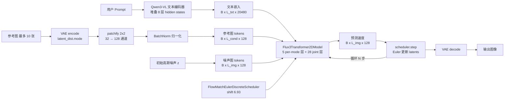
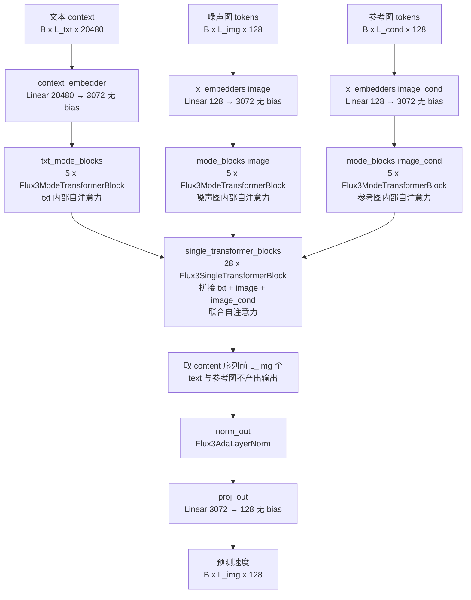
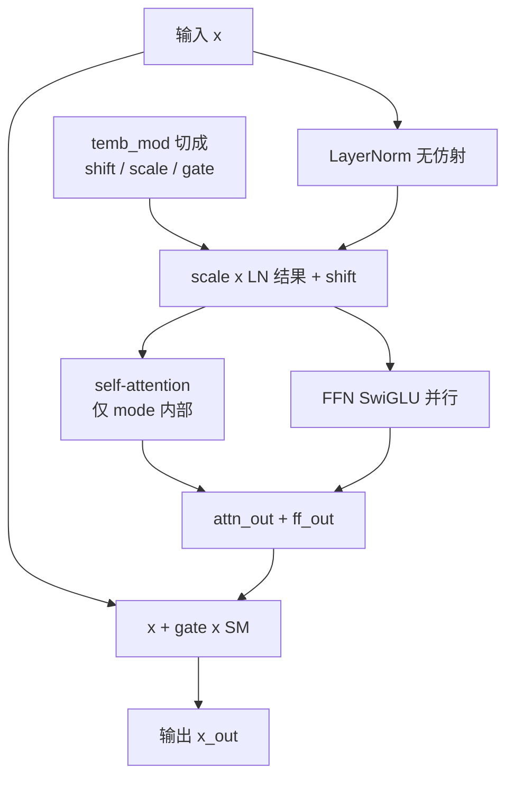
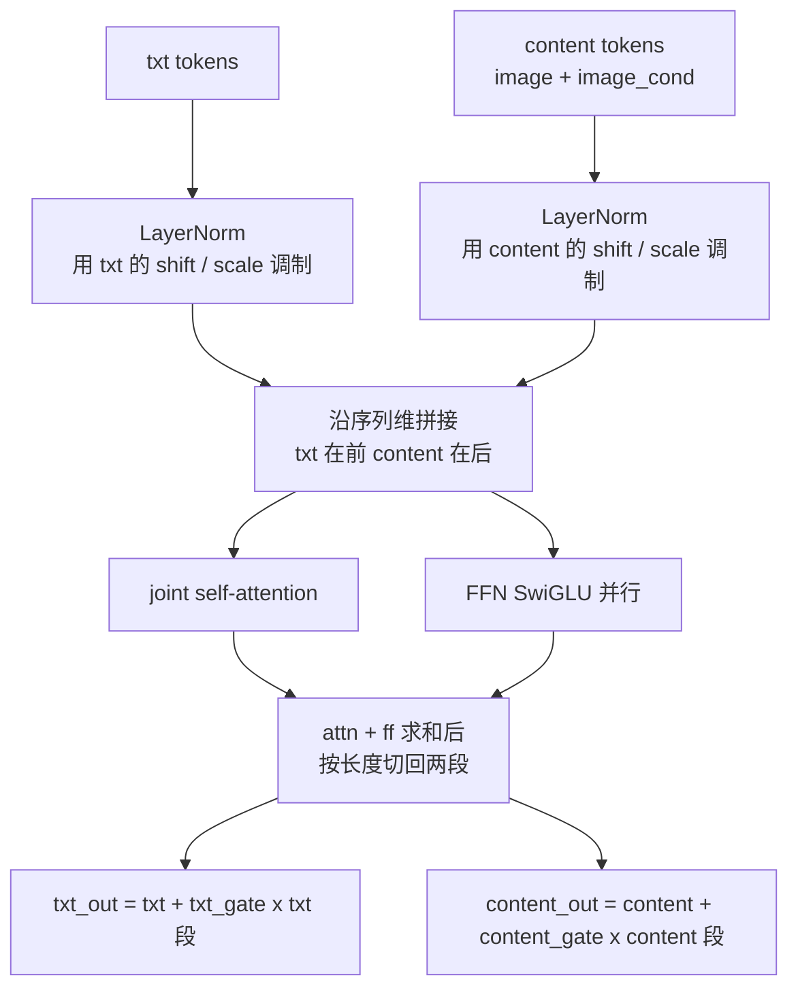
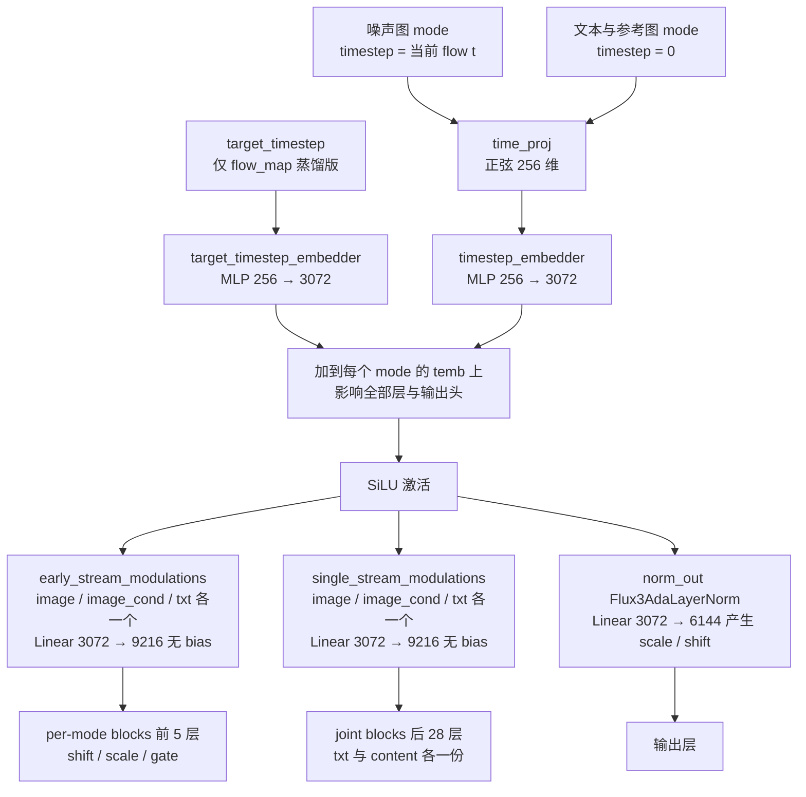
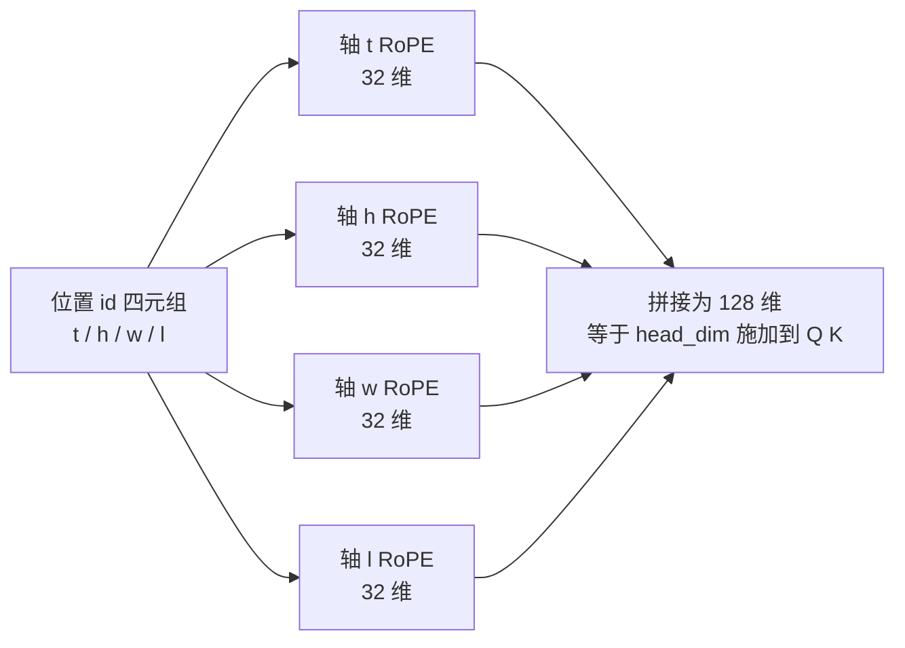
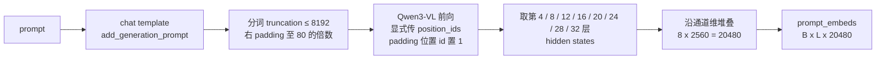
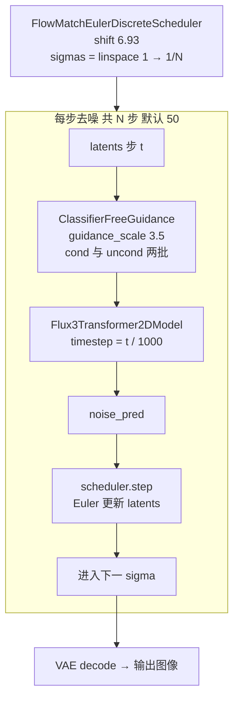

# FLUX.3 Image 模型结构

> 本文根据本仓库 vendored diffusers 的实现（`diffusers/src/diffusers/models/transformers/transformer_flux3.py` 与 `diffusers/src/diffusers/modular_pipelines/flux3/`）以及本地 checkpoint `flux-3-image-klein-base` 的配置整理，图示均为 Mermaid。

## 1. 总览

FLUX.3 是一个 rectified flow（flow matching）文生图 / 参考图编辑模型，整体为 **DiT 式 MM-DiT 架构**：VAE latent 经 2x2 patchify 展平为 token 序列，与 Qwen3-VL 文本 embedding、可选的参考图 latent token 拼接后送入 Transformer 去噪。

### 1.1 全流程数据流



### 1.2 组件清单（Klein Base checkpoint）

| 组件 | 类 | 参数量 | 精度 | 说明 |
|---|---|---|---|---|
| text_encoder | `Qwen3VLForConditionalGeneration` | ~4.2B | bf16 | 取 8 层 hidden states 堆叠作为文本条件 |
| tokenizer | `Qwen3VLProcessor` | - | - | chat template + 按 80 token 对齐 padding |
| transformer | `Flux3Transformer2DModel` | ~5.3B | bf16 | 去噪主干，5 个 per-mode block + 28 个 joint block |
| vae | `AutoencoderKLFlux2` | ~80M | fp32 | 8x 下采样，32 通道 latent，BN 归一化 |
| scheduler | `FlowMatchEulerDiscreteScheduler` | - | - | shift=6.93，线性 sigma |
| guider | `ClassifierFreeGuidance` | - | - | guidance_scale=3.5（默认） |
| prompt_upsampler（可选） | `Qwen3_5ForConditionalGeneration` | ~9B | bf16 | 独立模型，扩写简短提示词 |

## 2. Transformer 结构（Flux3Transformer2DModel）

### 2.1 配置参数（Klein Base 实际值）

| 参数 | 值 | 说明 |
|---|---|---|
| `in_channels` | 128 | 噪声图 token 通道数（32 latent 通道 x 2x2 patch） |
| `cond_in_channels` | 128 | 参考图 token 通道数 |
| `num_layers` | 5 | per-mode block 数（image / image_cond / txt 各一套） |
| `num_single_layers` | 28 | joint block 数 |
| `num_attention_heads` | 24 | 注意力头数 |
| `attention_head_dim` | 128 | 每头维度，`inner_dim = 24 x 128 = 3072` |
| `joint_attention_dim` | 20480 | 文本条件维度（8 层 x 2560） |
| `timestep_channels` | 256 | 正弦 timestep embedding 通道数 |
| `mlp_ratio` | 3.0 | FFN 扩展比 |
| `axes_dims_rope` | (32, 32, 32, 32) | RoPE 每轴维度，对应 (t, h, w, l) |
| `rope_theta` | 10000 | RoPE 基频 |
| `eps` | 1e-6 | LayerNorm / QK-Norm epsilon |
| `flow_map` | False | 蒸馏版为 True，增加 target_timestep embedder |

### 2.2 宏观结构

三种 token mode 共享一条联合序列：噪声图 tokens、可选的 VAE 编码参考图 tokens、文本 context。每个 mode 先过各自的 per-mode blocks（mode 内部自注意力），再拼接进 joint single blocks 做联合注意力，只有 image tokens 通过输出层产出预测。



### 2.3 模块清单

```python
Flux3Transformer2DModel
├── pos_embed: Flux3PosEmbed                    # 4D 轴向 RoPE，无参数
├── time_proj: Timesteps(256)                   # 正弦 timestep embedding
├── timestep_embedder: TimestepEmbedding        # 256 -> 3072（MLP）
├── target_timestep_embedder: TimestepEmbedding # 仅 flow_map=True；输出加到各 mode 的 temb
├── early_stream_modulations: ModuleDict        # {"image", "image_cond", "txt"} 各一个 Flux3Modulation
├── single_stream_modulations: ModuleDict       # 同上，供 joint block 使用
├── x_embedders: ModuleDict                     # {"image": Linear(128->3072), "image_cond": Linear(128->3072)}，无 bias
├── context_embedder: Linear(20480 -> 3072)     # 无 bias
├── mode_blocks: ModuleDict                     # {"image", "image_cond"} 各 5 个 Flux3ModeTransformerBlock
├── txt_mode_blocks: ModuleList                 # 5 个 Flux3ModeTransformerBlock
├── single_transformer_blocks: ModuleList       # 28 个 Flux3SingleTransformerBlock
├── norm_out: Flux3AdaLayerNorm                 # 输出自适应 LayerNorm
└── proj_out: Linear(3072 -> 128)               # 无 bias
```

### 2.4 Per-mode block（前 5 层，Flux3ModeTransformerBlock）

每个 token mode（噪声图 / 参考图 / 文本）有自己独立的 5 层 block，**自注意力只在 mode 内部进行**，互不交互。注意力和 FFN 并行共享同一次调制后的输入（parallel DiT 风格）：



```text
x_out = x + gate * (attn_out + ff_out)
norm_hidden = (1 + scale) * LayerNorm(x) + shift
```

### 2.5 Joint block（后 28 层，Flux3SingleTransformerBlock）

文本 token 与内容 token（噪声图，若有参考图则拼接在其后）拼成一条序列做联合自注意力，但 **两种 token 使用各自独立的调制参数**，这是图文信息真正交互的位置：



### 2.6 Attention 与 FFN

**Flux3Attention**：

- **无 cross-attention**：所有注意力都是 self-attention（per-mode 内部或 joint 拼接序列）。
- Q/K/V 投影均无 bias（支持 fused `to_qkv`），输出投影无 bias。
- **QK-Norm**：每个 head 维度上做 RMSNorm（`elementwise_affine=True`，eps=1e-6），以 fp32 计算后 cast 回原精度（`_keep_in_fp32_modules = ["norm_q", "norm_k"]`）。
- Q/K 上施加 4D 轴向 RoPE。

**Flux3FeedForward + Flux3SwiGLU**：SwiGLU，但 gate 投影融合进第一个 linear，因此 SwiGLU 模块本身无参数：

```text
linear_in:  3072 -> 18432 (2 x 3.0 x dim)   # 无 bias，gate 与 up 融合
SwiGLU:     SiLU(x[:, :9216]) * x[:, 9216:]  # 维度减半至 9216
linear_out: 9216 -> 3072                     # 无 bias
```

### 2.7 调制（Modulation）体系

FLUX.3 的条件注入完全靠 **per-token adaLN modulation**，没有 class/label embedding：



要点：

1. 条件向量 = `time_proj(timestep x 1000)` → `timestep_embedder` 升到 3072，batch 内广播到各 token 的 seq_len，是 per-token 调制。
2. **三种 mode 的 timestep 不同**：噪声图 token 用当前 flow timestep；参考图 token 和文本 token 固定用 timestep=0。
3. 每组 `Flux3Modulation` 输出 3 份 (shift, scale, gate)：`early_stream_modulations` 供 per-mode blocks（前 5 层），`single_stream_modulations` 供 joint blocks（后 28 层，文本/内容各一份）。
4. 输出层 `Flux3AdaLayerNorm`：`SiLU(temb) → Linear(3072 → 6144)` 产生 (scale, shift)，作用于 `norm_out(hidden) * (1 + scale) + shift`。

### 2.8 位置编码：4D 轴向 RoPE

`Flux3PosEmbed` 按 (t, h, w, l) 四个轴分别做 1D RoPE（每轴 32 维，共 128 维 = head_dim），theta=10000，频率用 float64 计算：



各 token 类型的位置 id 取值：

| token 类型 | t | h | w | l |
|---|---|---|---|---|
| 噪声图 | 0 | `arange(H')*0.5` | `arange(W')*0.5` | 0 |
| 参考图 i | 0 | `arange(H'_i)*0.5` | `arange(W'_i)*0.5` | -(i+1)，即 -1, -2, ... |
| 文本 | 0 | 0 | 0 | `arange(L_txt)` |

要点：

- 图像 H/W 位置乘以 `image_rope_scale=0.5`（训练 recipe 的一部分）。
- 参考图用负的 `l` 轴与生成图区分，多张参考图各占一段。
- 文本沿 `l` 轴推进；文本窗口右 padding 到 80 的倍数，且 **transformer 会 attend 到 padding token**（padding 位置 id 显式置 1，与训练环境 transformers 4.57 对齐）。

## 3. 文本编码（Qwen3-VL）



- 8 层 hidden states 堆叠后 reshape 为 `(B, L, 20480)` 直接作为 `encoder_hidden_states`（无额外投影，投影在 transformer 的 `context_embedder` 中完成）。
- CFG 开启时，negative prompt（默认空串）同样编码一份。

## 4. VAE 与 latent 打包（AutoencoderKLFlux2）


- 经典 KL-VAE，4 级 `DownEncoderBlock2D`（通道 128→256→512→512），8x 空间下采样，`latent_channels=32`。
- patchify 把 `(B, 32, H/8, W/8)` 重排为 `(B, 128, H/16, W/16)`。
- 用 VAE 内置 BatchNorm 的 running stats 归一化：`(latents - mean) / sqrt(var + 1e-4)`；decode 前需反向操作。
- 综合 scale factor = 16（VAE 8x x patch 2x2）：1024x1024 图像 → 64x64 = 4096 个 token，每 token 128 通道。
- 噪声以 float32 采样后 cast 到模型精度（保证与参考实现的 RNG 流一致，seed 可复现）。

## 5. 采样流程

### 5.1 Base（CFG）配方



- timesteps = sigmas x 1000，forward 里除回 1000 得到 [0, 1] 的 flow timestep。
- uncond 的文本 embedding 来自 negative prompt，默认空串。

### 5.2 蒸馏版（flow-map）

`flow_map=True` 的 checkpoint（step-distilled）：

- 增加独立的 `target_timestep_embedder`；forward 必须传 `target_timestep`（本步要跳到的下一个 timestep，最后一步为 0），其 embedding **加到所有 mode 的 temb 上**（同时影响 per-mode blocks、joint blocks 与输出层）。
- 不使用 CFG，无 negative prompt，默认 16 步。

## 6. 关键实现文件

| 文件 | 内容 |
|---|---|
| `diffusers/src/diffusers/models/transformers/transformer_flux3.py` | Transformer 主干（block / attention / modulation / RoPE） |
| `diffusers/src/diffusers/modular_pipelines/flux3/encoders.py` | Qwen3-VL 文本编码、参考图 VAE 编码与 BN 归一化 |
| `diffusers/src/diffusers/modular_pipelines/flux3/before_denoise.py` | timestep 调度、噪声/位置 id 准备、latent token 化 |
| `diffusers/src/diffusers/modular_pipelines/flux3/denoise.py` | 去噪循环（CFG 版 / flow-map 蒸馏版） |
| `diffusers/src/diffusers/modular_pipelines/flux3/modular_blocks_flux3.py` | pipeline 组装（text2image / image_conditioned 工作流） |
| `infer.py` | 本仓库推理入口（Klein Base） |
