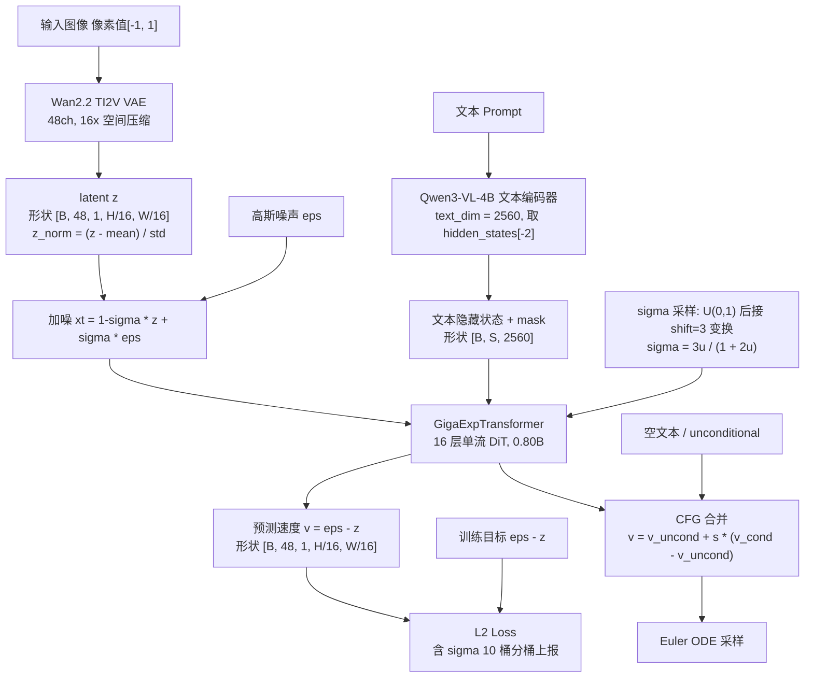
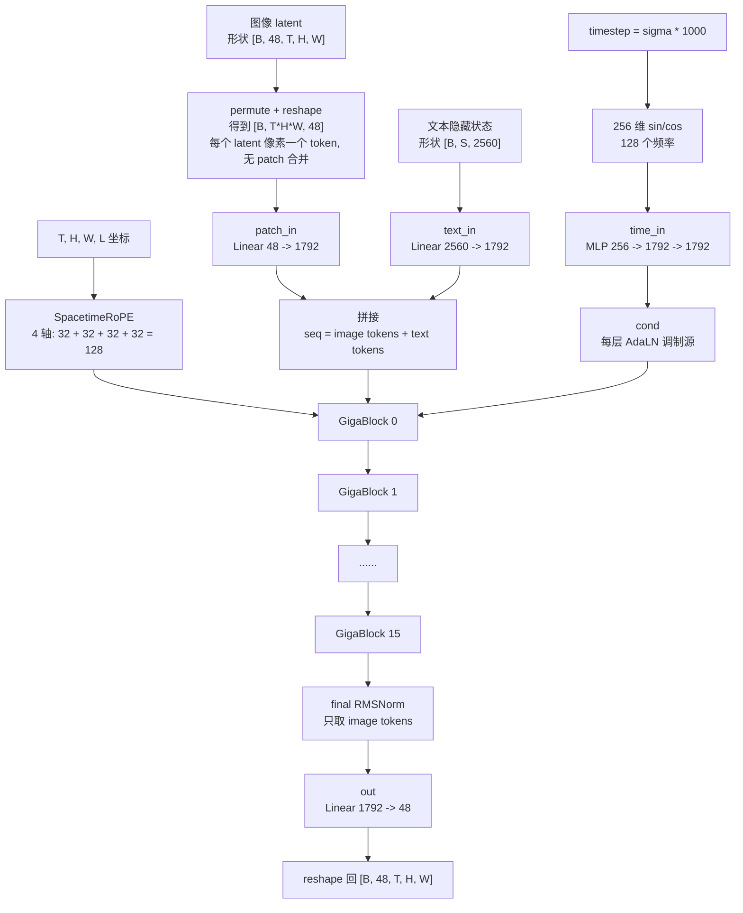
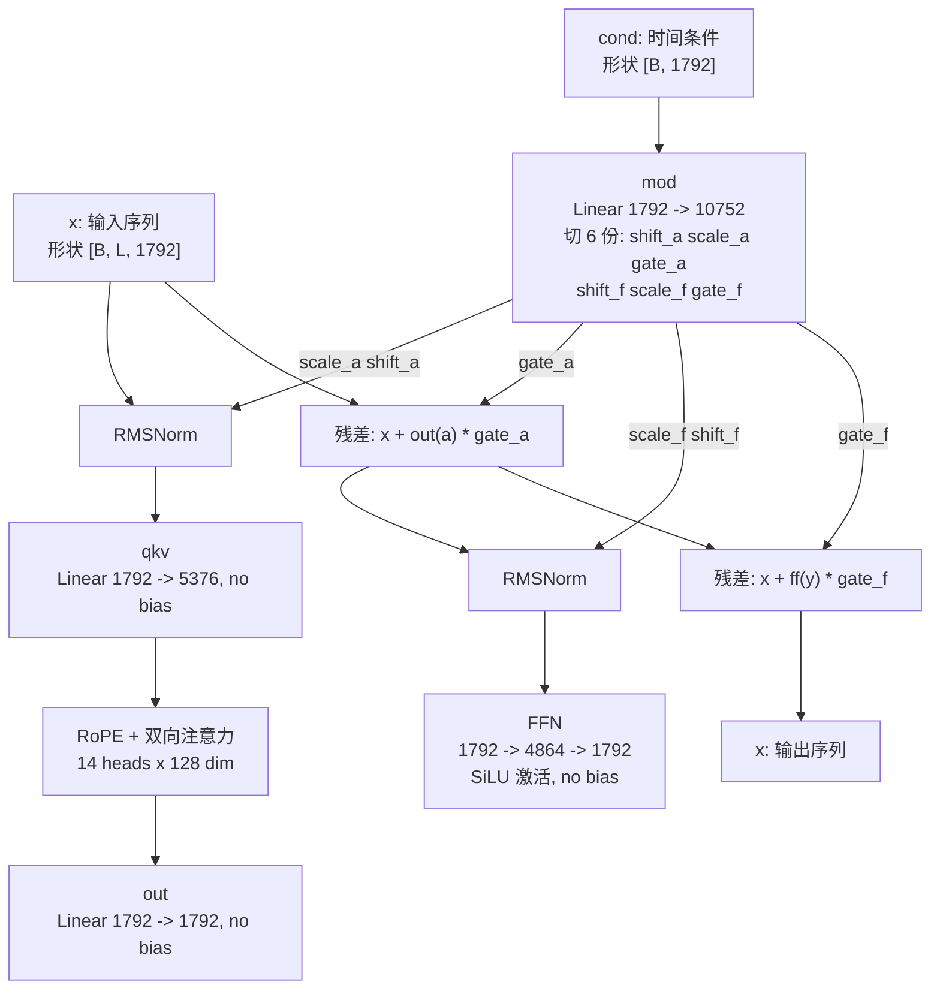

# Giga-Exp 模型结构

> 本文根据 `models/giga_transformer.py`（GigaExpTransformer）、`scripts/train/train_giga_exp.py` 及 `configs/stage_1*.yaml` 整理，所有参数量均为本地实例化实测值。

## 1. 总体结构

Giga-Exp 是一个 **0.80B 稠密 DiT** 的文本到图像 Flow Matching 模型，采用**单流（single-stream）**设计：图像 token 与文本 token 拼接后进同一组 Transformer Block 联合注意力。时间轴（T）在结构上完整保留，图像只是 T=1 的特例，因此可直接扩展到视频训练。推理使用 **Classifier-Free Guidance（CFG）**：条件分支与空文本 unconditional 分支共享同一个 DiT，批量前向后按 guidance scale 合并。



训练目标为 Flow Matching 的速度预测（v-prediction）：

```text
加噪:      xt = (1 - sigma) * z + sigma * eps
目标:      v* = eps - z
损失:      L = MSE(v_pred, v*)           (per-sample 再按 sigma 等宽 10 桶聚合)
sigma 采样: u ~ U(0,1), sigma = shift * u / (1 + (shift-1) * u), shift = 3.0
```

推理时用 Euler ODE 从 sigma=1（纯噪声）积分到 sigma=0（数据），每步 `x <- x - v / num_steps`。

## 2. 组件与职责

| 组件 | 实现 | 配置 / 作用 |
|---|---|---|
| Text Encoder | Qwen3-VL-4B-Instruct（`Qwen3VLForConditionalGeneration`，纯文本输入） | 输出 2560 维隐藏状态（hidden_states[-2]），bf16，max_length=512，pad token 被 mask 掉 |
| Tokenizer | Qwen2Tokenizer | 空 prompt 回退为 eos_token |
| VAE | AutoencoderKLWan（Wan2.2 TI2V-5B） | 48 通道 latent，16x 空间压缩，`z_norm = (z - mean) / std` 对齐官方约定 |
| DiT | GigaExpTransformer | 1792 宽度、16 层、14 头、单流联合注意力 |
| Attention 后端 | FlashAttention 3（`thirdparty/flash_attn_interface.py`）优先，回退 SDPA | FA3 仅在无 padding mask 且 bf16/fp16 CUDA 时启用 |
| 调度器 | 代码内实现（无 diffusers 依赖） | Flow Matching，训练 shift=3.0，验证 shift=3.0 |
| 优化器 | Muon(2D 参数) + AdamW(其余) | DeepSpeed ZeRO-2，bf16 混合精度 |

## 3. GigaExpTransformer 内部结构



### 3.1 Token 序列与位置编码

- 序列构成为 `image tokens` 在前、`text tokens` 在后，image token 数 = `T × H/16 × W/16`（每个 latent 像素 1 个 token，**没有 2x2 patchify**）。
- 4D SpacetimeRoPE 按 head_dim=128 切分为 `16(时间) + 48(高) + 48(宽) + 16(文本位置)`；图像时 T 恒为 1，但时间轴保留，升级视频时无需改结构。空间轴使用更多频率维度，文本轴保留独立位置编码。
- 图像 token 的四元坐标为 `(t, h, w, l=0)`；文本 token 的坐标为 `(t=0, h=0, w=0, l=1..S)`，文本拥有独立递增的位置编码，**不复用图像位置**。
- 文本位置轴 `l` 在不同视频帧数下保持独立于 `(t,h,w)`，因此图像与视频使用同一套 4D 坐标规则。

各训练分辨率的序列长度（image tokens，不含文本）：

| 阶段 | 分辨率 | latent (H/16 x W/16) | image tokens |
|---|---|---|---|
| stage_1 | 192p | 12 x 12 | 144 |
| stage_1_1 | 256p | 16 x 16 | 256 |
| stage_1_2 / stage_2_0 | 512p | 32 x 32 | 1024 |

加上最长 512 个文本 token，最长序列约 1536。

### 3.2 注意力 mask 的双路径

```text
text_mask 全有效 (无 padding):
    FA3 路径: flash_attn_func(q, k, v, causal=False), 布局 [B, S, H, D]
存在 padding:
    SDPA 路径: F.scaled_dot_product_attention(attn_mask=...)
    mask 构造: [全 1 的 image 段 | text_mask] 拼接 -> [B, 1, 1, image_len + S]
```

两条路径均先做 `q = q * cos + rotate_half(q) * sin` 的 RoPE 旋转，非因果（双向）注意力。

## 4. GigaBlock：单层结构

采用 **adaLN-zero 风格的每层独立调制**：每层有自己的 `mod` 层，从全局时间条件 `cond` 生成 6 组调制参数，分别作用于 attention 与 FFN 支路。



要点：

1. **调制**：`shift/scale` 作用于 Norm 之后（`norm(x) * (1 + scale) + shift`），`gate` 以零初始化风险的残差门控方式相加——本实现 gate 未做零初始化，直接由 `nn.Linear` 常规初始化输出。
2. **QKV/FFN 均无 bias**，仅 `mod`、`patch_in`、`text_in`、`time_in`、`out` 保留 bias。
3. **FFN** 为 `Linear(1792→4864) → SiLU → Linear(4864→1792)`（门控仅在外层残差，FFN 内部无 GLU）。

## 5. 参数量明细（实测）

总量 **801,395,888 ≈ 0.80B**，bf16 权重约 1.6 GB。

| 部分 | 参数量 | 占比 |
|---|---|---|
| 16 x GigaBlock | 792,952,832 (49,559,552/层) | 98.6% |
| patch_in (48→1792) | 87,808 | 0.01% |
| text_in (2560→1792) | 4,593,792 | 0.57% |
| time_in (256→1792→1792) | 3,673,600 | 0.46% |
| final norm + out (1792→48) | 87,856 | 0.01% |

单层 GigaBlock 内部（共 49.56M）：

| 子层 | 参数量 |
|---|---|
| mod (1792→10752 + bias) | 19,278,336 |
| ff (1792→4864→1792) | 17,432,576 |
| qkv (1792→5376) | 9,633,792 |
| attn out (1792→1792) | 3,211,264 |
| norm1 + norm2 | 3,584 |

## 6. 关键配置速查

```text
hidden dimension        1792
FFN dimension           4864
attention heads         14  (head_dim = 128)
main DiT layers         16
latent channels         48  (Wan2.2 VAE)
text hidden dimension   2560  (Qwen3-VL-4B-Instruct, hidden_states[-2])
timestep embedding      256 (128 频率 sin/cos) -> 1792
RoPE axes (t/h/w/l)     16 / 48 / 48 / 16, theta = 10000
RoPE for image tokens   (t, h, w, l=0)
RoPE for text tokens    (t=0, h=0, w=0, l=1..S)
CFG guidance scale      3.0 (validation/inference)
CFG training dropout    0.1 (empty-text unconditional training)
scheduler               flow matching, shift = 3.0 (uniform u)
attention               bidirectional, FA3 优先 / SDPA 回退
```

## 7. 与 MOSS-Image-SFT 的主要差异

| 维度 | MOSS-Image-SFT | Giga-Exp |
|---|---|---|
| 规模 | 42 层 / 3072 宽 | 16 层 / 1792 宽（0.80B） |
| VAE | FLUX.2 VAE，128ch | Wan2.2 TI2V VAE，48ch |
| 结构 | 双流（文本有独立 TextBlock） | **单流**联合注意力 |
| 文本位置编码 | 4D RoPE 含文本位置 | 4D RoPE 含文本位置 |
| CFG | guidance 3.0，空文本 unconditional 分支 | guidance 3.0，空文本 unconditional 分支 |
| 时间维 | 图像专用 | **T 保留**，RoPE 含时间轴，可平移到视频 |
| 时间调制 | shared modulation | 每层独立 mod 层（adaLN-zero 风格） |
