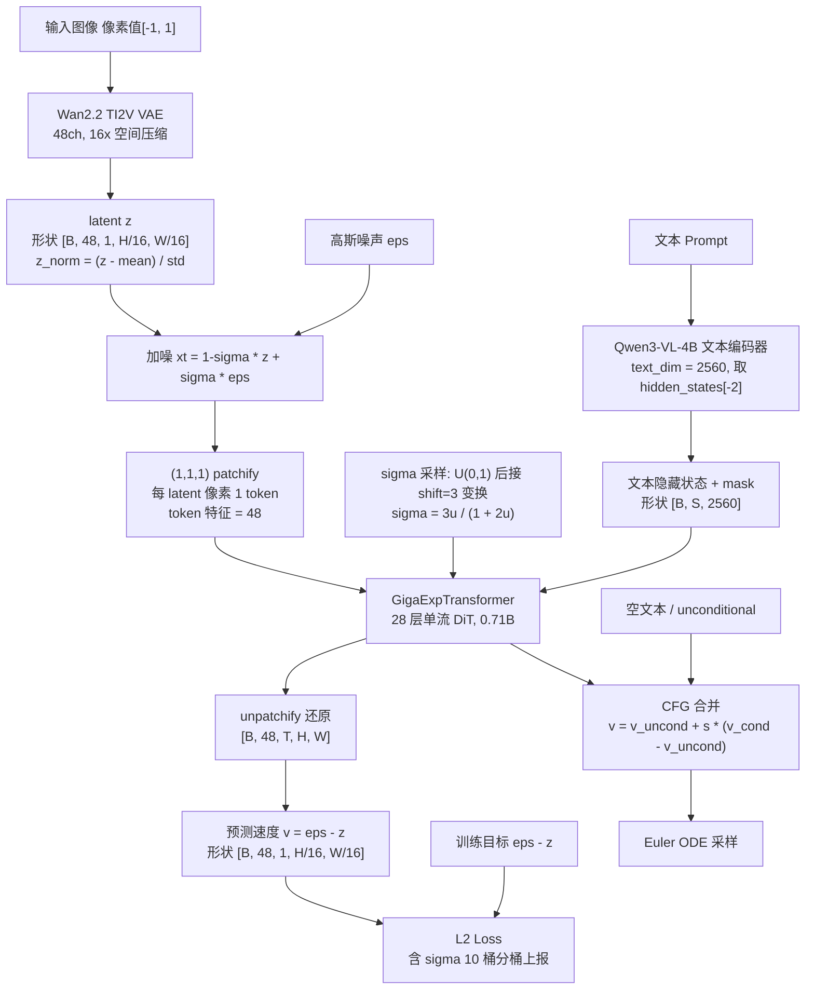
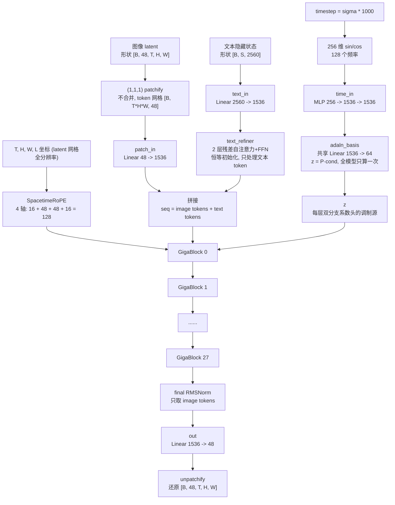
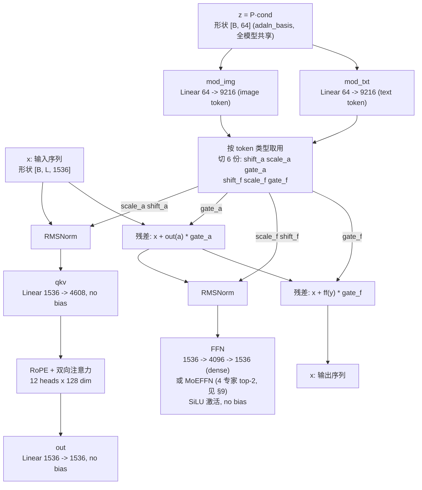

# Giga-Exp 模型结构

> 本文根据 `models/giga_transformer.py`（GigaExpTransformer）、`scripts/train/train_giga_exp.py` 及 `configs/stage_1*.yaml` 整理，所有参数量均为本地实例化实测值。

## 1. 总体结构

Giga-Exp 是一个 **0.71B 稠密 DiT** 的文本到图像 Flow Matching 模型（stage_1_28layers：28 层 / dim 1536 / 12 头 / FFN 4096，basis AdaLN 结构；bf16 权重约 1.43GB），采用**单流（single-stream）**设计：图像 token 与文本 token 拼接后进同一组 Transformer Block 联合注意力。文本 token 在投影后先经过一个 **Text Refiner**（MOSS-Image 风格，2 层残差自注意力+FFN，恒等初始化）再进主 DiT。时间轴（T）在结构上完整保留，图像只是 T=1 的特例，因此可直接扩展到视频训练。latent 进入 Transformer 前 patchify：**当前全部配置为 (1,1,1)**（每 latent 像素 1 token，不合并；历史结构为 (1,2,2) 空间 2x2 合并，已统一迁移，见 §3.1）。推理使用 **Classifier-Free Guidance（CFG）**：条件分支与空文本 unconditional 分支共享同一个 DiT，批量前向后按 guidance scale 合并。

> 变体：XL 配置（`configs/stage_1_xl.yaml`，36 层 / dim 2048 / FFN 8192 / 16 头，≈2B）与 XL MoE 配置（`configs/stage_1_xl_moe.yaml`，FFN 换 top-2 路由 MoE，总参 ≈4.80B / 激活 ≈2.92B），见 §9。

> 历史：早期配置为 16 层 / 1792 宽 / 0.80B（shared AdaLN），后扩到 28 层并引入 dual-branch（MiniMax H3 风格）与 basis 共享基结构，见 §4。



训练目标为 Flow Matching 的速度预测（v-prediction）：

```text
加噪:      xt = (1 - sigma) * z + sigma * eps
目标:      v* = eps - z
损失:      L = MSE(v_pred, v*)           (per-sample 再按 sigma 等宽 10 桶聚合)
sigma 采样: u ~ U(0,1), sigma = shift * u / (1 + (shift-1) * u), shift = 3.0
```

推理时用 Euler ODE 从 sigma=1（纯噪声）积分到 sigma=0（数据），每步 `x <- x - v / num_steps`。

## 2. 组件与职责

| 组件 | 实现 | 配置 / 作用 |
|---|---|---|
| Text Encoder | Qwen3-VL-4B-Instruct（`Qwen3VLForConditionalGeneration`，纯文本输入） | 输出 2560 维隐藏状态（hidden_states[-2]），bf16，max_length=512，pad token 被 mask 掉 |
| Tokenizer | Qwen2Tokenizer | 空 prompt 回退为 eos_token |
| VAE | AutoencoderKLWan（Wan2.2 TI2V-5B） | 48 通道 latent，16x 空间压缩，`z_norm = (z - mean) / std` 对齐官方约定 |
| DiT | GigaExpTransformer | 1536 宽度、28 层、12 头、单流联合注意力，(1,1,1) patchify（每 latent 像素 1 token），basis r=64 AdaLN + 2 层 Text Refiner |
| Attention 后端 | FlashAttention 3（`thirdparty/flash_attn_interface.py`）优先，回退 SDPA | FA3 仅在无 padding mask 且 bf16/fp16 CUDA 时启用 |
| 调度器 | 代码内实现（无 diffusers 依赖） | Flow Matching，训练 shift=3.0，验证 shift=3.0 |
| 优化器 | AdamW（默认）；Muon+AdamW 实现保留但 `muon.enabled: false` | DeepSpeed ZeRO-2（configs/zero1.json，8 卡），bf16 混合精度，lr=1e-4 cosine + 200 warmup |

## 3. GigaExpTransformer 内部结构



### 3.1 Token 序列、patchify 与位置编码

- **(1,1,1) patchify（当前）**：`patch_size = (pt, ph, pw) = (1, 1, 1)`，不做任何合并，每 latent 像素 1 token，token 特征维 = 48（与 MOSS-Image 相同的"无 patchify"方案）。动机：空间信息无损进入 Transformer，分辨率扩展时 token 数更可控。历史结构为 (1,2,2)（空间 2x2 合并、token 特征 192），所有配置已统一切换，旧 (1,2,2) ckpt 加载时 `patch_in` 输入权重自动 2x2 扩展、`out` 权重复制到各 patch 位置（红字提示，见 §7.1 路径 2）。
- 序列构成为 `image tokens` 在前、`text tokens` 在后，image token 数 = `T × (H/16) × (W/16)`（仅 VAE 16x 压缩）。
- 4D SpacetimeRoPE 按 head_dim=128 切分为 `16(时间) + 48(高) + 48(宽) + 16(文本位置)`；RoPE 坐标使用 **latent 全分辨率 token 网格** `(t, h, w)`（(1,1,1) patchify 下即 VAE 网格本身；历史上 (1,2,2) 时为网格一半分辨率）。图像时 T 恒为 1，但时间轴保留，升级视频时无需改结构。
- 图像 token 的四元坐标为 `(t, h, w, l=0)`；文本 token 的坐标为 `(t=0, h=0, w=0, l=1..S)`，文本拥有独立递增的位置编码，**不复用图像位置**。
- 文本位置轴 `l` 在不同视频帧数下保持独立于 `(t,h,w)`，因此图像与视频使用同一套 4D 坐标规则。

当前 stage_1 使用 512p 三桶（512_square 0.45 / 512x384 0.275 / 384x512 0.275，cover 裁剪无黑边）：

| bucket | latent (H/16 x W/16) | patchify 后网格 | image tokens |
|---|---|---|---|
| 512_square | 32 x 32 | 32 x 32 | 1024 |
| 512x384 / 384x512 | 32 x 24 / 24 x 32 | 32 x 24 / 24 x 32 | 768 |

加上最长 512 个文本 token，最长序列约 1536。

### 3.2 注意力 mask 的双路径

```text
text_mask 全有效 (无 padding):
    FA3 路径: flash_attn_func(q, k, v, causal=False), 布局 [B, S, H, D]
存在 padding:
    SDPA 路径: F.scaled_dot_product_attention(attn_mask=...)
    mask 构造: [全 1 的 image 段 | text_mask] 拼接 -> [B, 1, 1, image_len + S]
```

两条路径均先做 `q = q * cos + rotate_half(q) * sin` 的 RoPE 旋转，非因果（双向）注意力。

## 4. GigaBlock：单层结构与 AdaLN

调制采用 **basis 结构（默认，`model.adaln_type: basis`，r=64）**：全模型共享一个 `adaln_basis` Linear(dim→r) 把时间条件投影为 `z = P·cond`（每次前向只算一次），每层再各有 `mod_img` / `mod_txt` 两个 Linear(r→6·dim) 系数头——image token 吃 `mod_img` 的 6 组调制，text token 吃 `mod_txt` 的 6 组，分别作用于 attention 与 FFN 支路。

`adaln_type` 三选一（yaml 显式注明；未注明时按旧 `mod_adaln` bool 推导，向后兼容）：

| 类型 | 结构 | adaLN 参数（28 层实测） |
|---|---|---|
| `shared` | 每层一个 Linear(1536→9216)，img/text 共用 | 406.6M |
| `dual` | 每层 mod_img/mod_txt 两个全秩 Linear（MiniMax H3 风格） | 793.2M（占模型 53.8%） |
| `basis` | 共享 Linear(1536→64) + 每层双分支 Linear(64→9216) | **33.6M（占模型 4.7%）** |

basis 的依据：调制只依赖 timestep，输入永远落在曲线 c(t) 张成的低维子空间（实测 56 条调制曲线有效秩 ~32-64）。转换取曲线协方差 top-r 主方向为 P、`A_i = W_i Pᵀ`，在 t 网格上实测 r=64 调制曲线 RMS 误差 **0.19%**（曲线能量捕获 99.994%）。

**旧 ckpt 兼容**：训练/推理加载时 `apply_adaln_basis_migration` 自动检测 ckpt 结构——已是 basis 直接加载；dual/shared 全秩 ckpt 就地低秩转换后加载（**先转换再训练**），并打印红字警告；basis 模型之外回退原 `apply_mod_adaln_migration`（shared→dual 拷贝无损热启动）。推理端调制为 GEMV，可整条 t 网格预计算，成本可忽略。



要点：

1. **调制**：`shift/scale` 作用于 Norm 之后（`norm(x) * (1 + scale) + shift`），`gate` 以零初始化风险的残差门控方式相加——本实现 gate 未做零初始化，直接由 `nn.Linear` 常规初始化输出。
2. **QKV/FFN 均无 bias**，`adaln_basis` 也无 bias；`mod_img`/`mod_txt` 系数头与 `patch_in`、`text_in`、`time_in`、`out` 保留 bias。
3. **FFN** 为 `Linear(1536→4096) → SiLU → Linear(4096→1536)`（门控仅在外层残差，FFN 内部无 GLU）。配置 `model.moe` 时 FFN 替换为 `MoEFFN`（`models/giga_transformer.py` GigaBlock：`moe is not None` 分支），见 §9。
4. **Text Refiner**（`text_trans`）：text_in 投影后、进主 DiT 前的 2 层残差自注意力+FFN（12 头，仅文本序列、无 AdaLN），残差支路输出层零初始化 → step0 恒等，旧 ckpt 无 `text_refiner.*` 时自动恒等初始化。

## 5. 参数量明细（实测，stage_1.yaml：28 层 / dim 1536 / basis r=64）

> 注：本节实测基于历史 (1,2,2) patchify 权重；当前配置 patch_size=(1,1,1) 后 `patch_in` 变为 48→1536、`out` 变为 1536→48，两项合计由 593,088 降为 150,576（推算），总量 ≈ 713.8M，其余不变。

总量 **714,245,824 ≈ 0.71B**，bf16 权重约 1.43 GB。（对照：同结构改 `adaln_type: dual` 为 1,473,840,832 ≈ 1.47B / 2.95 GB——adaLN 差异全部来自调制参数。）

| 部分 | 参数量 | 占比 |
|---|---|---|
| 28 x GigaBlock 主干 (qkv/attn-out/ff/norm) | 616,655,872 (22,023,424/层) | 86.3% |
| adaLN 系数头 (blocks.*.mod_img/mod_txt, 含 bias) | 33,546,240 (1,198,080/层) | 4.7% |
| text_refiner (2 层) | 56,663,040 (28,331,520/层) | 7.9% |
| text_in (2560→1536, 含 bias) | 3,933,696 | 0.55% |
| time_in (256→1536→1536) | 2,755,584 | 0.39% |
| patch_in (48→1536) / out (1536→48) / final norm（(1,1,1)，推算） | 150,576 | 0.02% |
| adaln_basis (1536→64, 全模型共享) | 98,304 | 0.01% |

单层 GigaBlock 内部（共 23.22M）：

| 子层 | 参数量 |
|---|---|
| ff (1536→4096→1536) | 12,582,912 |
| qkv (1536→4608) | 7,077,888 |
| attn out (1536→1536) | 2,359,296 |
| mod_img + mod_txt (64→9216, 含 bias) | 1,198,080 |
| norm1 + norm2 + q_norm + k_norm | 3,712 |

注：adaLN 系数头 + adaln_basis 合计 33.6M（4.7%）。dual 全秩时每层 mod 为 2×(1536×9216+9216)=28.4M/层、共 793.2M（53.8%），是旧 0.80B 配置换成 28 层后参数膨胀的主因；basis 结构把这部分压缩回 1/24。

## 6. 关键配置速查

```text
hidden dimension        1536
FFN dimension           4096
attention heads         12  (head_dim = 128)
main DiT layers         28
text refiner layers     2   (text_trans: dim 1536, ffn 4096, heads 12)
adaln_type              basis   # shared | dual | basis (旧 ckpt 加载时自动转换)
adaln_rank              64      # 共享基维度, adaLN 793M -> 33.6M
latent channels         48  (Wan2.2 VAE)
patch size (t/h/w)      (1, 1, 1)  不合并, 每 latent 像素 1 token (旧 ckpt 自动迁移)
patch_in / out          Linear 48->1536 / Linear 1536->48
text hidden dimension   2560  (Qwen3-VL-4B-Instruct, hidden_states[-2])
timestep embedding      256 (128 频率 sin/cos) -> 1536
RoPE axes (t/h/w/l)     16 / 48 / 48 / 16, theta = 10000 (latent 全分辨率网格)
RoPE for image tokens   (t, h, w, l=0)
RoPE for text tokens    (t=0, h=0, w=0, l=1..S)
CFG guidance scale      3.0 (validation/inference)
CFG training dropout    0.1 (empty-text unconditional training)
scheduler               flow matching, shift = 3.0 (uniform u)
attention               bidirectional, FA3 优先 / SDPA 回退
optimizer               AdamW (lr 1e-4, cosine, warmup 200, wd 0.01); Muon 实现保留但默认关闭
precision               bf16 mixed, DeepSpeed ZeRO-2 (zero1.json), grad clip 1.0
```

## 7. 优化器与 ZeRO-2 分片 Muon（实现保留，默认关闭）

当前 `stage_1.yaml` 默认使用**纯 AdamW**（`optimizer.type: adamw`，`muon.enabled: false`）。Muon 路径的实现如下，需要时在 yaml 打开：

优化器为 `MuonAdamW` 封装（`train_giga_exp.py`）：hidden 2D 矩阵交给 **Muon**（`torch.optim.Muon`，`momentum=0.95`、`weight_decay=0.0`、`adjust_lr_fn=match_rms_adamw`、lr = AdamW base lr 的 3 倍系数 `"3x"`），输出头 `out.*` 与全部 1D 参数（bias/norm）交给 **AdamW**（betas 0.9/0.95, eps 1e-8）。

DeepSpeed ZeRO-2 会把 Muon 组的全部 2D 参数按顺序 flatten 成一个 **1D fp32 分片**（每 rank 连续一段），因此封装内做了分片 step（`_step_partitioned_muon`）：

```text
1. all-gather 各 rank 的 1D 梯度分片 -> 拼回完整梯度; momentum 分片同理
2. 按 matrix_shapes 逐矩阵还原 [rows, cols]:
   momentum lerp -> (nesterov) -> Newton-Schulz zeropower -> match_rms_adamw 调 lr
3. 每个 rank 只把落在本 rank 区间 [rank*n, (rank+1)*n) 的更新段写回分片
4. momentum 分片写回各自区间
```

该路径已通过两层验证（`scripts/train/test_zero2_muon.py`）：真实 2 卡 ZeRO-2 下与未分片官方 Muon/AdamW **逐步数值等价**（重组 FP32 主权重每步最大误差 0），并覆盖 checkpoint 保存/恢复一致性。注意：分片判断依据是"参数被 DeepSpeed flatten 成 1D"（当前 DeepSpeed 0.19.x 行为），world size 变化后不保证 Muon optimizer state 可恢复。

### 7.1 断点恢复策略（resume_mode: auto）

三级降级，前一级失败自动落到下一级：

```text
1. 完整 DeepSpeed state (模型 + Muon/AdamW state + lr scheduler + step)
2. 兼容纯权重恢复: load_compatible_state_dict
   - 形状一致参数逐位继承
   - AdaLN 结构自动迁移 (先转换再训练, 红字警告):
     basis 模型遇 dual/shared 全秩 ckpt -> apply_adaln_basis_migration
     低秩转换 (曲线主方向 top-r, r=64 曲线 RMS 误差 ~0.2%);
     dual 模型遇 shared ckpt -> apply_mod_adaln_migration 拷贝无损热启动
   - patchify 形状变化时迁移: patch_in 旧输入权重扩展 2x2,
     out 旧权重/bias 复制到每个 patch 位置
   - step 从文件名继承 (step-00036000.safetensors -> step=36000),
     optimizer 状态重置
3. 从 0 开始
```

结构变更（如引入 patchify、AdaLN 切 basis）后的重启即走路径 2：权重与 step 继承、optimizer 重置。注意 optimizer 状态跨 AdaLN 结构不可恢复（参数形状已变），必须走纯权重路径。

### 7.2 验证产物

每次 validation（every_n_steps）按 rank 落盘 `validation/step-XXXXXXXX/rankN.png` 与 `rankN.json`：黑色背景对比图（上行 INPUT 红 / 下行 GEN 蓝），prompt 以黄色自动换行写在图顶；JSON 保存 step/rank/seed/采样配置/分辨率/负向 prompt/prompts/图片名。验证 prompt 来自训练 batch（use_next_batch），各 rank/step 不可横向精确对比。

## 8. 与 MOSS-Image-SFT 的主要差异

| 维度 | MOSS-Image-SFT | Giga-Exp |
|---|---|---|
| 规模 | 42 层 / 3072 宽（≈4.9B） | 28 层 / 1536 宽（0.71B） |
| VAE | FLUX.2 VAE，128ch | Wan2.2 TI2V VAE，48ch |
| 结构 | 双流（文本有独立 TextBlock） | **单流**联合注意力 + 2 层 Text Refiner |
| latent patchify | 无（每 latent 像素 1 token） | **(1,1,1)**，与 MOSS 相同（历史为 (1,2,2)） |

## 9. XL 与 MoE 变体

### 9.1 stage_1_xl（稠密 ≈2B）

`configs/stage_1_xl.yaml`：36 层 / dim 2048 / FFN 8192 / 16 头 / basis r=64 / patch (1,1,1)，参数量 ≈2B。训练吞吐由分层 Dense→MoE→Dense 预算解决，见下节。

### 9.2 stage_1_xl_moe（top-2 MoE FFN，总参 ≈4.80B / 激活 ≈2.92B）

`configs/stage_1_xl_moe.yaml` + `models/moe.py`，对齐 moe-h3 的 SparseMoE/Router 行为，按 DiT 特性适配：

- **分层 Dense→MoE→Dense**：36 层中**首 4 层与末 4 层保持 dense FFN**，中间 28 层换 `MoEFFN`（4 专家、top-2 路由，每 expert 与原 dense FFN 同构），用首尾层的显存换总参容量；
- **Router 全程 fp32**：输入与 gate 权重上浮 float32 计算 logits，softmax/topk/aux loss 全 fp32（权重存储精度由 DeepSpeed ZeRO 引擎管理，每 step 覆写）；
- **RoutingSchedule 三阶段强制均衡**：A 期（`phase_a_steps=500`）balanced random top-2 强制均衡（与 gate logits 无关）；B 期（至 `phase_b_end_step=2000`）learned_probability 线性递增混入学习路由，jitter 0.5→0.1 线性衰减；C 期纯学习路由 + jitter 0.03，推理恒用学习路由；
- **aux loss 四件套**（权重在 MoEFFN 内乘好，训练侧直接累加）：load_balance（Switch 风格，1e-2）+ router_z_loss（1e-3）+ entropy（默认 0）+ warmup_ce（默认 0）；
- **dispatch**：按专家 argsort 分组计算，布尔掩码选 token，空 expert 走空张量前向（无 host 同步，梯度自动为零）；
- **热启动迁移**：从 dense ckpt upcycle——每个 expert 拷贝原 dense FFN 权重、router gate 置零，训练从 `init_from` 指定的 warmup ckpt 启动；
- **观测**：`moe_stats.py` 收集各层 aux loss、expert 流量占比、pre-AdaLN RMS 比（gated_residual_rms_ratio）等 `moe_metrics` 输出到训练日志。
| 文本位置编码 | 4D RoPE 含文本位置 | 4D RoPE 含文本位置 |
| CFG | guidance 3.0，空文本 unconditional 分支 | guidance 3.0，空文本 unconditional 分支 |
| 时间维 | 图像专用 | **T 保留**，RoPE 含时间轴，可平移到视频 |
| 时间调制 | 全模型 1 个 shared_block_modulation（42 层共用，占 1.6%） | basis r=64：共享基 + 每层 img/txt 双分支系数头（占 4.7%），保留每层调制曲线 |
