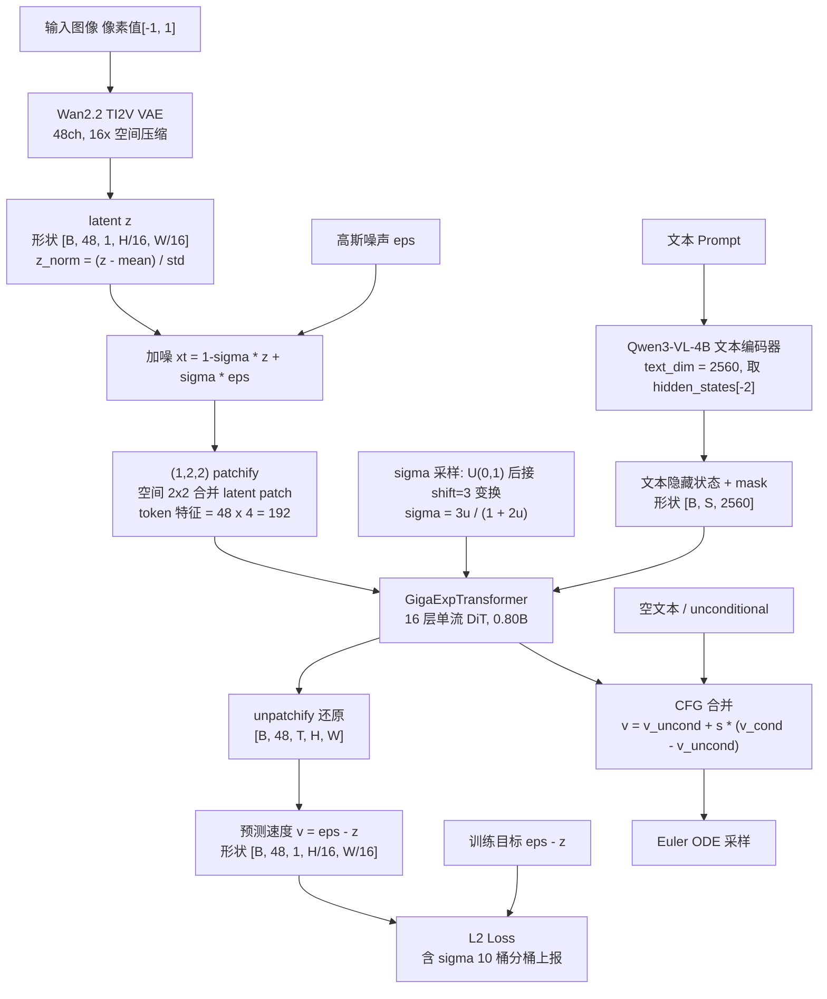
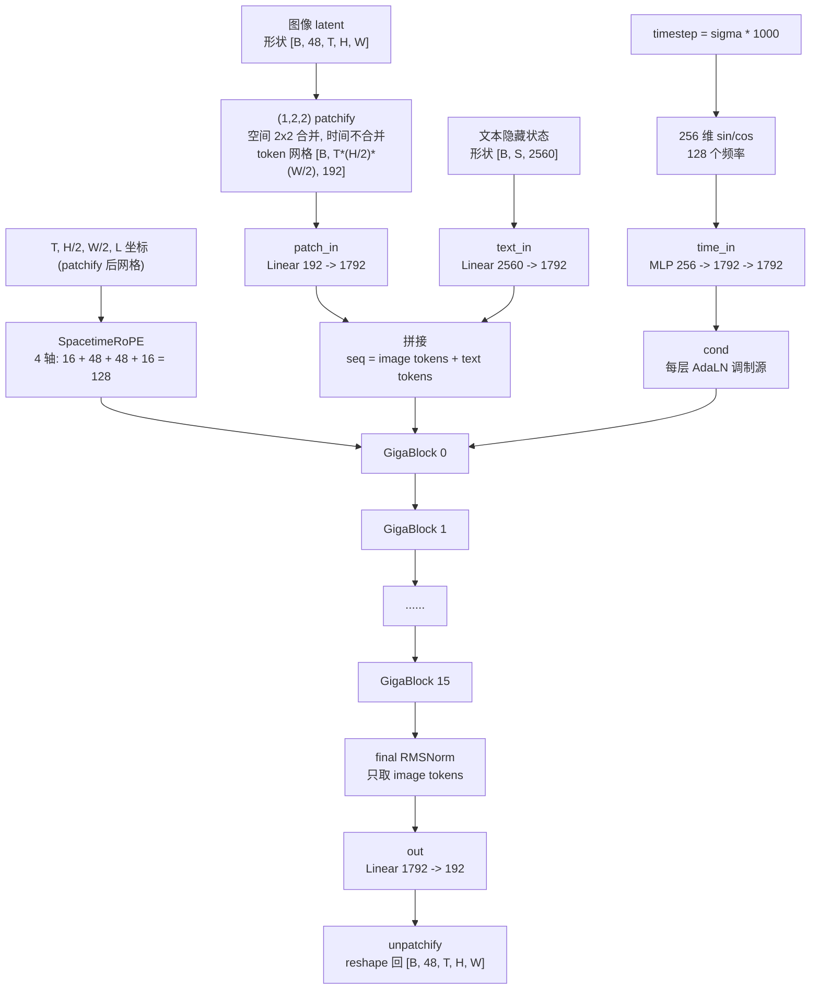
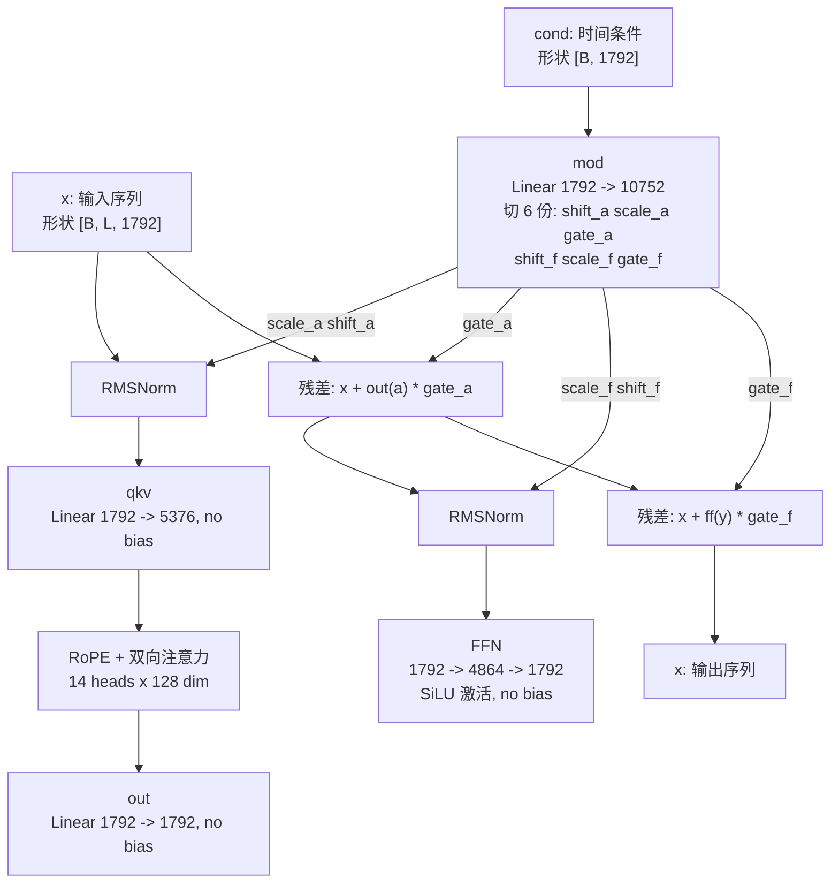

# Giga-Exp 模型结构

> 本文根据 `models/giga_transformer.py`（GigaExpTransformer）、`scripts/train/train_giga_exp.py` 及 `configs/stage_1*.yaml` 整理，所有参数量均为本地实例化实测值。

## 1. 总体结构

Giga-Exp 是一个 **0.80B 稠密 DiT** 的文本到图像 Flow Matching 模型，采用**单流（single-stream）**设计：图像 token 与文本 token 拼接后进同一组 Transformer Block 联合注意力。时间轴（T）在结构上完整保留，图像只是 T=1 的特例，因此可直接扩展到视频训练。latent 在进入 Transformer 前做 **(1,2,2) patchify**（时间维不合并、空间 2x2 合并），以 1/4 的图像 token 数换取训练吞吐。推理使用 **Classifier-Free Guidance（CFG）**：条件分支与空文本 unconditional 分支共享同一个 DiT，批量前向后按 guidance scale 合并。



训练目标为 Flow Matching 的速度预测（v-prediction）：

```text
加噪:      xt = (1 - sigma) * z + sigma * eps
目标:      v* = eps - z
损失:      L = MSE(v_pred, v*)           (per-sample 再按 sigma 等宽 10 桶聚合)
sigma 采样: u ~ U(0,1), sigma = shift * u / (1 + (shift-1) * u), shift = 3.0
```

推理时用 Euler ODE 从 sigma=1（纯噪声）积分到 sigma=0（数据），每步 `x <- x - v / num_steps`。

## 2. 组件与职责

| 组件 | 实现 | 配置 / 作用 |
|---|---|---|
| Text Encoder | Qwen3-VL-4B-Instruct（`Qwen3VLForConditionalGeneration`，纯文本输入） | 输出 2560 维隐藏状态（hidden_states[-2]），bf16，max_length=512，pad token 被 mask 掉 |
| Tokenizer | Qwen2Tokenizer | 空 prompt 回退为 eos_token |
| VAE | AutoencoderKLWan（Wan2.2 TI2V-5B） | 48 通道 latent，16x 空间压缩，`z_norm = (z - mean) / std` 对齐官方约定 |
| DiT | GigaExpTransformer | 1792 宽度、16 层、14 头、单流联合注意力，(1,2,2) patchify |
| Attention 后端 | FlashAttention 3（`thirdparty/flash_attn_interface.py`）优先，回退 SDPA | FA3 仅在无 padding mask 且 bf16/fp16 CUDA 时启用 |
| 调度器 | 代码内实现（无 diffusers 依赖） | Flow Matching，训练 shift=3.0，验证 shift=3.0 |
| 优化器 | Muon(2D 参数) + AdamW(输出头/1D) | DeepSpeed ZeRO-2，Muon 参数被 flatten 为 1D 分片，step 时 all-gather 重组后逐矩阵执行 Newton-Schulz，bf16 混合精度 |

## 3. GigaExpTransformer 内部结构



### 3.1 Token 序列、patchify 与位置编码

- **(1,2,2) patchify**：`patch_size = (pt, ph, pw) = (1, 2, 2)`，时间维不合并、空间 2x2 合并。latent `[B, C, T, H, W]` 先 reshape 为 `[B, C, T, H/2, 2, W/2, 2]`，再排布为 `[B, T*(H/2)*(W/2), pt*ph*pw*C]`，即每个 token 特征维 `4 x 48 = 192`。patch 内通道序为 `(pt, ph, pw, c)`；unpatchify 是完全互逆的 reshape + permute。
- 序列构成为 `image tokens` 在前、`text tokens` 在后，image token 数 = `T × (H/32) × (W/32)`（VAE 16x 压缩 x patchify 2x2）。
- 4D SpacetimeRoPE 按 head_dim=128 切分为 `16(时间) + 48(高) + 48(宽) + 16(文本位置)`；RoPE 坐标使用 **patchify 后的 token 网格** `(t, h, w)`（即 latent 网格的一半分辨率）。图像时 T 恒为 1，但时间轴保留，升级视频时无需改结构。
- 图像 token 的四元坐标为 `(t, h, w, l=0)`；文本 token 的坐标为 `(t=0, h=0, w=0, l=1..S)`，文本拥有独立递增的位置编码，**不复用图像位置**。
- 文本位置轴 `l` 在不同视频帧数下保持独立于 `(t,h,w)`，因此图像与视频使用同一套 4D 坐标规则。

各训练分辨率的 image token 数（不含文本，方形 bucket；非方形 bucket 按网格直积计算）：

| 阶段 | 分辨率 | latent (H/16 x W/16) | patchify 后网格 | image tokens |
|---|---|---|---|---|
| stage_1 | 192p | 12 x 12 | 6 x 6 | 36 (旧配置无 patchify 为 144) |
| stage_1_1 | 256p | 16 x 16 | 8 x 8 | 64 |
| stage_1_2 / stage_2_0 | 512p | 32 x 32 | 16 x 16 | 256 |

加上最长 512 个文本 token，最长序列约 768。

### 3.2 注意力 mask 的双路径

```text
text_mask 全有效 (无 padding):
    FA3 路径: flash_attn_func(q, k, v, causal=False), 布局 [B, S, H, D]
存在 padding:
    SDPA 路径: F.scaled_dot_product_attention(attn_mask=...)
    mask 构造: [全 1 的 image 段 | text_mask] 拼接 -> [B, 1, 1, image_len + S]
```

两条路径均先做 `q = q * cos + rotate_half(q) * sin` 的 RoPE 旋转，非因果（双向）注意力。

## 4. GigaBlock：单层结构

采用 **adaLN-zero 风格的每层独立调制**：每层有自己的 `mod` 层，从全局时间条件 `cond` 生成 6 组调制参数，分别作用于 attention 与 FFN 支路。



要点：

1. **调制**：`shift/scale` 作用于 Norm 之后（`norm(x) * (1 + scale) + shift`），`gate` 以零初始化风险的残差门控方式相加——本实现 gate 未做零初始化，直接由 `nn.Linear` 常规初始化输出。
2. **QKV/FFN 均无 bias**，仅 `mod`、`patch_in`、`text_in`、`time_in`、`out` 保留 bias。
3. **FFN** 为 `Linear(1792→4864) → SiLU → Linear(4864→1792)`（门控仅在外层残差，FFN 内部无 GLU）。

## 5. 参数量明细（实测，(1,2,2) patchify 配置）

总量 **801,907,648 ≈ 0.80B**，bf16 权重约 1.6 GB。

| 部分 | 参数量 | 占比 |
|---|---|---|
| 16 x GigaBlock | 792,952,832 (49,559,552/层) | 98.9% |
| patch_in (192→1792, 含 bias) | 345,856 | 0.04% |
| text_in (2560→1792, 含 bias) | 4,589,312 | 0.57% |
| time_in (256→1792→1792) | 3,673,600 | 0.46% |
| final norm (1792) + out (1792→192) | 346,048 | 0.04% |

单层 GigaBlock 内部（共 49.56M）：

| 子层 | 参数量 |
|---|---|
| mod (1792→10752 + bias) | 19,278,336 |
| ff (1792→4864→1792) | 17,432,576 |
| qkv (1792→5376) | 9,633,792 |
| attn out (1792→1792) | 3,211,264 |
| norm1 + norm2 | 3,584 |

## 6. 关键配置速查

```text
hidden dimension        1792
FFN dimension           4864
attention heads         14  (head_dim = 128)
main DiT layers         16
latent channels         48  (Wan2.2 VAE)
patch size (t/h/w)      (1, 2, 2)  时间不合并, 空间 2x2
patch_in / out          Linear 192->1792 / Linear 1792->192
text hidden dimension   2560  (Qwen3-VL-4B-Instruct, hidden_states[-2])
timestep embedding      256 (128 频率 sin/cos) -> 1792
RoPE axes (t/h/w/l)     16 / 48 / 48 / 16, theta = 10000 (patchify 后网格)
RoPE for image tokens   (t, h, w, l=0)
RoPE for text tokens    (t=0, h=0, w=0, l=1..S)
CFG guidance scale      3.0 (validation/inference)
CFG training dropout    0.1 (empty-text unconditional training)
scheduler               flow matching, shift = 3.0 (uniform u)
attention               bidirectional, FA3 优先 / SDPA 回退
optimizer               Muon(2D, lr=3x, match_rms_adamw, wd=0) + AdamW(out.*/1D)
precision               bf16 mixed, DeepSpeed ZeRO-2, grad clip 1.0
```

## 7. 优化器与 ZeRO-2 分片 Muon

优化器为 `MuonAdamW` 封装（`train_giga_exp.py`）：hidden 2D 矩阵交给 **Muon**（`torch.optim.Muon`，`momentum=0.95`、`weight_decay=0.0`、`adjust_lr_fn=match_rms_adamw`、lr = AdamW base lr 的 3 倍系数 `"3x"`），输出头 `out.*` 与全部 1D 参数（bias/norm）交给 **AdamW**（betas 0.9/0.95, eps 1e-8）。

DeepSpeed ZeRO-2 会把 Muon 组的全部 2D 参数按顺序 flatten 成一个 **1D fp32 分片**（每 rank 连续一段），因此封装内做了分片 step（`_step_partitioned_muon`）：

```text
1. all-gather 各 rank 的 1D 梯度分片 -> 拼回完整梯度; momentum 分片同理
2. 按 matrix_shapes 逐矩阵还原 [rows, cols]:
   momentum lerp -> (nesterov) -> Newton-Schulz zeropower -> match_rms_adamw 调 lr
3. 每个 rank 只把落在本 rank 区间 [rank*n, (rank+1)*n) 的更新段写回分片
4. momentum 分片写回各自区间
```

该路径已通过两层验证（`scripts/train/test_zero2_muon.py`）：真实 2 卡 ZeRO-2 下与未分片官方 Muon/AdamW **逐步数值等价**（重组 FP32 主权重每步最大误差 0），并覆盖 checkpoint 保存/恢复一致性。注意：分片判断依据是"参数被 DeepSpeed flatten 成 1D"（当前 DeepSpeed 0.19.x 行为），world size 变化后不保证 Muon optimizer state 可恢复。

### 7.1 断点恢复策略（resume_mode: auto）

三级降级，前一级失败自动落到下一级：

```text
1. 完整 DeepSpeed state (模型 + Muon/AdamW state + lr scheduler + step)
2. 兼容纯权重恢复: load_compatible_state_dict
   - 形状一致参数逐位继承
   - patchify 形状变化时迁移: patch_in 旧输入权重扩展 2x2,
     out 旧权重/bias 复制到每个 patch 位置
   - step 从文件名继承 (step-00036000.safetensors -> step=36000),
     optimizer 状态重置
3. 从 0 开始
```

结构变更（如引入 patchify）后的重启即走路径 2：权重与 step 继承、optimizer 重置。

### 7.2 验证产物

每次 validation（every_n_steps）按 rank 落盘 `validation/step-XXXXXXXX/rankN.png` 与 `rankN.json`：黑色背景对比图（上行 INPUT 红 / 下行 GEN 蓝），prompt 以黄色自动换行写在图顶；JSON 保存 step/rank/seed/采样配置/分辨率/负向 prompt/prompts/图片名。验证 prompt 来自训练 batch（use_next_batch），各 rank/step 不可横向精确对比。

## 8. 与 MOSS-Image-SFT 的主要差异

| 维度 | MOSS-Image-SFT | Giga-Exp |
|---|---|---|
| 规模 | 42 层 / 3072 宽 | 16 层 / 1792 宽（0.80B） |
| VAE | FLUX.2 VAE，128ch | Wan2.2 TI2V VAE，48ch |
| 结构 | 双流（文本有独立 TextBlock） | **单流**联合注意力 |
| latent patchify | 无（每 latent 像素 1 token） | **(1,2,2) patchify**，空间 token x1/4 |
| 文本位置编码 | 4D RoPE 含文本位置 | 4D RoPE 含文本位置 |
| CFG | guidance 3.0，空文本 unconditional 分支 | guidance 3.0，空文本 unconditional 分支 |
| 时间维 | 图像专用 | **T 保留**，RoPE 含时间轴，可平移到视频 |
| 时间调制 | shared modulation | 每层独立 mod 层（adaLN-zero 风格） |
