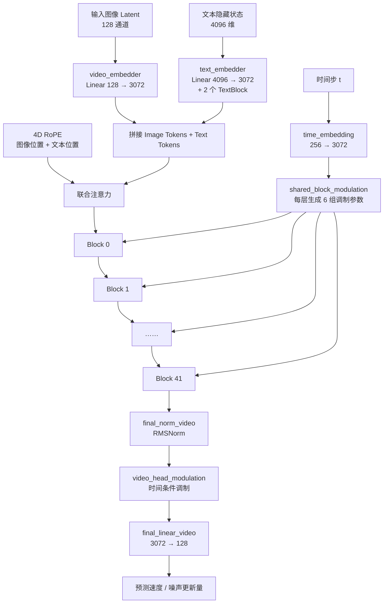
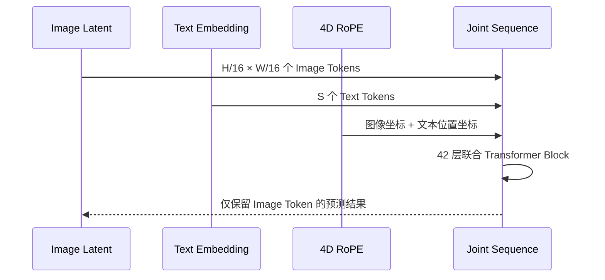

# MOSS-Image-SFT 模型结构

> 本文根据本地 checkpoint `/home/jovyan/pfs/users/zhanqian.wu/ckpt/MOSS-Image-SFT` 及其 `pipeline_moss_image.py` 整理。

## 1. 总体结构

MOSS-Image-SFT 是一个文本到图像扩散模型，主干由 Qwen 文本编码器、MOSS-Image DiT、Flow Matching Euler 调度器和 FLUX.2 VAE 解码器组成。


*上图为 checkpoint 附带的效果展示，下面的 Mermaid 图展示对应的模型数据流。*

```mermaid
flowchart LR
    P[用户 Prompt\n自然语言 / JSON Layout] --> T[Qwen3.5 文本编码器\ntext_dim = 4096]
    T --> E[文本嵌入\n[B, S, 4096]]
    E --> D[MOSSImageTransformer\n42 层 DiT]
    N[初始高斯噪声\n[B, 128, H/16, W/16]] --> D
    S[MOSSImageScheduler\nFlowMatch Euler\nshift = 5] --> D
    D --> L[去噪 Latent\n[B, 128, H/16, W/16]]
    L --> V[AutoencoderKLFlux2\nVAE 解码器]
    V --> I[输出图像\n[B, 3, H, W]]
```

## 2. 组件与职责

| 组件 | 配置 / 作用 |
|---|---|
| Tokenizer | Qwen2Tokenizer，负责 Prompt 分词和 Chat Template 格式化 |
| Text Encoder | Qwen3.5Model，输出 4096 维文本隐藏状态 |
| Transformer | MOSSImageTransformer，3072 hidden dim、24 heads、42 层 |
| Scheduler | MOSSImageScheduler，Flow Matching Euler，推理默认 50 步 |
| VAE | AutoencoderKLFlux2，将 128 通道 latent 解码为 RGB 图像 |
| CFG | 默认 guidance scale 为 3.0，negative branch 默认跳过第 22 个 DiT block |

## 3. MOSSImageTransformer 内部结构



### 关键参数

```text
hidden dimension       3072
FFN dimension          8192
attention heads        24
main DiT layers        42
text hidden dimension  4096
latent channels        128
RoPE base              10000
```

每个主干 Block 包含：

1. RMSNorm 和 AdaLN 风格的时间调制；
2. Q/K/V/O 投影和 RoPE 旋转位置编码；
3. Scaled Dot-Product Attention；
4. 门控 FFN，使用 SiTU 激活；
5. 残差连接。

## 4. Token 与位置编码

图像 latent 经过空间展平后形成 Image Tokens，文本编码结果形成 Text Tokens。两者拼接后进行联合注意力：



RoPE 使用四维坐标 `(r, f, h, w)`：图像 token 使用居中的二维空间坐标，文本 token 使用序列位置。Transformer 最后只取图像 token，并恢复成 `[B, 128, H/16, W/16]`。

## 5. 参数规模与显存直觉

MOSS-Image-SFT 的主要显存消耗来自：

- 42 层 DiT 主干参数；
- Qwen3.5 文本编码器；
- 联合注意力中的 Image Tokens 与 Text Tokens；
- VAE 解码阶段的中间激活。

因此推理脚本默认使用：

- Transformer 和 Text Encoder：`bfloat16`；
- VAE：`float32`；
- 初始噪声、CFG 和 Euler 更新：`float32`；
- 显存不足时可使用 `--cpu-offload`。
