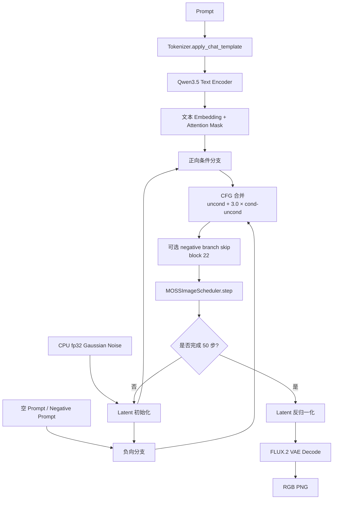
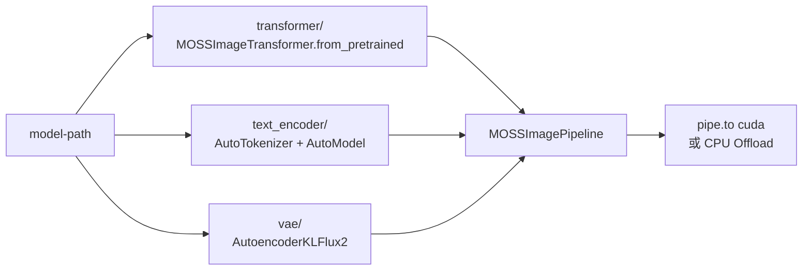

# MOSS-Image-SFT 推理流程

本文说明 [infer_moss_image.py](../infer_moss_image.py) 如何加载本地 checkpoint，并完成从 Prompt 到图片的完整推理过程。


*示例图来自本地 MOSS-Image-SFT checkpoint，用于说明模型对图像中文字和布局的生成能力。*

## 1. 推理总览



## 2. 本地组件加载

checkpoint 目录结构如下：

```text
MOSS-Image-SFT/
├── text_encoder/
│   ├── config.json
│   └── model-*.safetensors
├── tokenizer/
├── transformer/
│   ├── config.json
│   └── diffusion_pytorch_model-*.safetensors
├── vae/
│   ├── config.json
│   └── diffusion_pytorch_model.safetensors
├── scheduler/
└── pipeline_moss_image.py
```

加载入口位于 [infer_moss_image.py](../infer_moss_image.py#L50-L61)：



默认 dtype：

| 模块 | dtype | 原因 |
|---|---|---|
| MOSS DiT | `torch.bfloat16` | 降低显存并保持较好的数值稳定性 |
| Qwen 文本编码器 | `torch.bfloat16` | 与 DiT 文本投影维度匹配 |
| FLUX.2 VAE | `torch.float32` | 提高解码质量和稳定性 |
| 初始噪声 / CFG / Scheduler 更新 | `torch.float32` | 减少累积误差 |

## 3. 单步采样过程

```mermaid
flowchart TB
    Z[当前 Latent z_t] --> C[MOSS DiT\npositive prompt]
    Z --> U[MOSS DiT\nnegative prompt]
    U --> SKIP[negative branch 跳过 block 22]
    C --> VC[v_cond]
    SKIP --> VU[v_uncond]
    VC --> CFG[v = v_uncond + s × (v_cond - v_uncond)]
    VU --> CFG
    CFG --> STEP[Euler step]
    STEP --> ZN[下一步 Latent z_t-1]
```

默认参数：

```text
height / width       1024 × 1024
num_inference_steps  50
guidance_scale        3.0
negative_prompt       空字符串
uncond_skip_layers    [22]
seed                  42
```

关闭 negative branch skip：

```bash
python infer_moss_image.py \
  'A glass greenhouse in a quiet garden.' \
  --uncond-skip-layers \
  --output outputs/no_skip.png
```

## 4. 标准文生图命令

```bash
cd /home/jovyan/pfs/users/zhanqian.wu/code/model_exp

CUDA_VISIBLE_DEVICES=0 python infer_moss_image.py \
  'A wide view of a refrigerator beside a kitchen counter with a fruit bowl. A small sticky note on the refrigerator door is handwritten in Chinese: "记得买牛奶和鸡蛋！"' \
  --height 1024 \
  --width 1024 \
  --steps 50 \
  --guidance-scale 3.0 \
  --seed 42 \
  --output outputs/refrigerator.png
```

## 5. JSON Layout Prompt

MOSS-Image-SFT 支持将场景、文字和空间位置写成 JSON。下面的布局使用 `yxyx` 和 `abs_centralized` 坐标约定：

```json
{
  "summary": {
    "caption": "A clean whiteboard showing a simple project plan."
  },
  "bbox_format": "yxyx",
  "bbox_coord_space": "abs_centralized",
  "items": [
    {
      "type": "text",
      "text": "项目计划",
      "bbox": [-420, -360, 420, -180]
    },
    {
      "type": "text",
      "text": "设计 → 开发 → 发布",
      "bbox": [-420, 20, 420, 180]
    }
  ]
}
```

命令行中可用单引号包裹 JSON：

```bash
python infer_moss_image.py \
  '{"summary":{"caption":"A clean whiteboard showing a simple project plan."},"bbox_format":"yxyx","bbox_coord_space":"abs_centralized","items":[{"type":"text","text":"项目计划","bbox":[-420,-360,420,-180]}]}' \
  --output outputs/layout.png
```

## 6. 显存不足时的 CPU Offload

```bash
CUDA_VISIBLE_DEVICES=0 python infer_moss_image.py \
  'A detailed watercolor illustration of a mountain village.' \
  --cpu-offload \
  --output outputs/village.png
```

`--cpu-offload` 使用 Diffusers 的模块级 CPU offload，使 Text Encoder、Transformer 和 VAE 按需移动到 GPU。它通常可以降低峰值显存，但会牺牲部分速度。

## 7. 输出阶段

```mermaid
flowchart LR
    A[Latent 128 × H/16 × W/16] --> B[BatchNorm 反归一化]
    B --> C[2×2 latent 重排]
    C --> D[FLUX.2 VAE Decode]
    D --> E[[-1, 1] clamp]
    E --> F[VaeImageProcessor]
    F --> G[PIL Image]
    G --> H[output PNG]
```

注意：`height` 和 `width` 必须是正的 16 的倍数，因为图像空间会先经过 16 倍下采样，再在 VAE 阶段还原。

## 8. 常见问题

### CUDA 不可用

脚本会在启动时检查 `torch.cuda.is_available()`。MOSS-Image-SFT 的当前入口不提供 CPU 推理模式，需要使用 CUDA GPU。

### 找不到模型文件

使用 `--model-path` 指定包含 `transformer/`、`text_encoder/` 和 `vae/` 的完整模型目录：

```bash
python infer_moss_image.py \
  'A cat sitting beside a window.' \
  --model-path /home/jovyan/pfs/users/zhanqian.wu/ckpt/MOSS-Image-SFT
```

### 图像尺寸不合法

例如 `1024`、`768`、`512` 合法；`1000` 不合法。请保证：

```text
height % 16 == 0
width % 16 == 0
```
